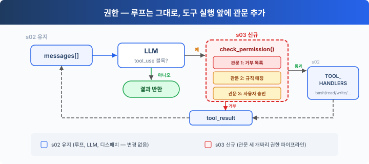
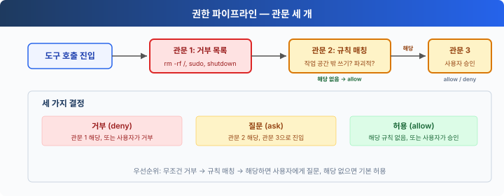

# s03: 권한 — 실행 전에 권한을 확인합니다

[English](README.md) · [中文](README.zh.md) · [日本語](README.ja.md) · [한국어](README.ko.md)

s01 → s02 → `s03` → [s04](../s04_hooks/) → s05 → ... → s16 → s17
> *"Check permissions before executing"* — 권한 파이프라인이 어떤 작업에 승인이 필요한지 정합니다.
>
> **하네스 레이어**: 권한 — 도구 실행 앞에 놓인 관문입니다.

---

## 문제

s02의 에이전트에는 도구가 5개 있습니다. 파일 도구는 `safe_path`로 보호되지만 bash에는 아무 제한이 없습니다. "프로젝트를 정리해 줘"라고 하면 `rm -rf /`를 실행할 수도 있습니다.

안전은 모델을 믿는 데 기댈 수 없습니다. 코드가 필요합니다. 도구를 실행하기 전마다 확인하는 코드입니다.

---

## 해결 방법



s02의 루프는 그대로 둡니다. 바뀌는 것은 도구 실행 앞에 `check_permission()`을 넣는 것 하나뿐입니다. 모든 도구 호출은 정해진 순서로 관문 세 개를 지납니다. 먼저 무조건 거부를 확인하고, 다음으로 사용자에게 물어볼지 확인하고, 어느 쪽에도 해당하지 않으면 허용합니다.

세 관문은 세 가지 결정에 대응합니다.

| 관문 | 목적 | 해당될 때 |
|------|---------|----------|
| 1. 거부 목록 | 언제나 금지되는 작업(`rm -rf /`, `sudo`) | 즉시 거부하고 실행하지 않음 |
| 2. 규칙 매칭 | 상황에 따라 달라지는 작업(작업 공간 밖 읽기/쓰기, `rm`으로 파일 삭제) | 관문 3으로 넘김 |
| 3. 사용자 승인 | 관문 2에 해당하면 멈추고 사용자 확인을 기다림 | 사용자가 허용 또는 거부를 결정 |

세 관문 어디에도 해당하지 않으면 → 바로 실행합니다. 일상적인 작업은 대부분 이 경로를 탑니다.

---

## 동작 방식



**관문 1**: 무조건 거부하는 목록입니다. 가장 먼저 확인하고, 해당하면 차단 메시지를 돌려줍니다. 이 목록은 권한 관문이 어디에 놓이는지 보여 주려고 단순한 문자열 매칭을 씁니다. 완전한 보안 경계는 아닙니다.

```python
DENY_LIST = [
    "rm -rf /", "sudo", "shutdown", "reboot",
    "mkfs", "dd if=", "> /dev/sda",
]

def check_deny_list(command: str) -> str | None:
    for pattern in DENY_LIST:
        if pattern in command:
            return f"Blocked: '{pattern}' is on the deny list"
    return None
```

**관문 2**: 규칙 매칭입니다. "언제 사용자에게 물어볼지"를 적어 둡니다. 규칙마다 도구와 확인 조건을 지정합니다.

```python
import re

DESTRUCTIVE_COMMAND_WORD = re.compile(
    r"(?i)(?:^|[;&|()\n])\s*(?:rm|del)(?=\s|$|[;&|()])"
)

def contains_destructive_command(command: str) -> bool:
    return bool(DESTRUCTIVE_COMMAND_WORD.search(command))

PERMISSION_RULES = [
    {
        "tools": ["read_file", "write_file", "edit_file"],
        "check": lambda args: not (WORKDIR / args.get("path", "")).resolve().is_relative_to(WORKDIR),
        "message": "Access outside workspace",
    },
    {
        "tools": ["bash"],
        "check": lambda args: contains_destructive_command(args.get("command", "")) or any(
            kw in args.get("command", "") for kw in ["rm ", "> /etc/", "chmod 777"]
        ),
        "message": "Potentially destructive command",
    },
]

def check_rules(tool_name: str, args: dict) -> str | None:
    for rule in PERMISSION_RULES:
        if tool_name in rule["tools"] and rule["check"](args):
            return rule["message"]
    return None
```

**관문 3**: 규칙에 해당하면 멈추고 사용자 입력을 기다립니다.

```python
def ask_user(tool_name: str, args: dict, reason: str) -> str:
    print(f"\n⚠  {reason}")
    print(f"   Tool: {tool_name}({args})")
    choice = input("   Allow? [y/N] ").strip().lower()
    return "allow" if choice in ("y", "yes") else "deny"
```

**세 관문을 하나로 이어** 도구 실행 앞에 넣습니다.

```python
def check_permission(block) -> bool:
    # Gate 1: Hard deny
    if block.name == "bash":
        reason = check_deny_list(block.input.get("command", ""))
        if reason:
            print(f"\n⛔ {reason}")
            return False

    # Gate 2 + 3: Rule matching → User approval
    reason = check_rules(block.name, block.input)
    if reason:
        decision = ask_user(block.name, block.input, reason)
        if decision == "deny":
            return False

    return True

# In agent_loop — s02's loop with just one line added:
for block in tool_calls:
    if not check_permission(block):           # ← NEW
        results.append({... "content": "Permission denied."})
        continue
    output = TOOL_HANDLERS[block.name](**block.input)  # s02 original
    results.append(...)
```

---

## s02와 달라진 점

| 구성 요소 | 이전 (s02) | 이후 (s03) |
|-----------|-------------|-------------|
| 보안 모델 | 없음(모델을 믿음) | 관문 세 개로 된 권한 파이프라인 |
| 새 함수 | — | check_deny_list, check_rules, ask_user, check_permission |
| 루프 | 모든 도구를 바로 실행 | 실행 앞에 check_permission()을 넣음 |

---

## 직접 해 보기

```sh
cd learn-claude-code
python s03_permission/code.py
```

다음 프롬프트를 입력해 보세요.

1. `Create a file called test.txt in the current directory` (그대로 통과해야 합니다)
2. `Delete the file test.txt` (bash + rm 조합이 관문 2에 걸립니다)
3. `What files are in the current directory?` (읽기 전용이라 모두 통과합니다)
4. `Try to write a file to /etc/something` (작업 공간 밖에 쓰려 하므로 관문 2에 걸립니다)
5. Windows에서는 `del test.txt`와 `DEL test.txt`가 관문 2에 걸리고, `model`, `delimiter`, `echo del test.txt`는 걸리지 않습니다.

어떤 작업이 그대로 통과하는지, 어떤 작업에 확인이 필요한지, 어떤 작업이 바로 거부되는지 살펴보세요.

---

## 다음 장

권한 확인은 갖췄습니다. 하지만 모든 확인이 루프 안에 `check_permission()`으로 하드코딩되어 있습니다. 도구를 실행하기 전후에 로그를 남기고 싶다면 어떻게 할까요? 특정 작업 뒤에 git commit을 자동으로 실행하고 싶다면요? 이런 확장 로직을 루프 곳곳에 흩어 놓으면 루프가 비대해집니다.

→ s04 훅: 루프에 훅을 답니다. 확장 로직은 훅에 걸고, 루프는 깔끔하게 유지합니다.
