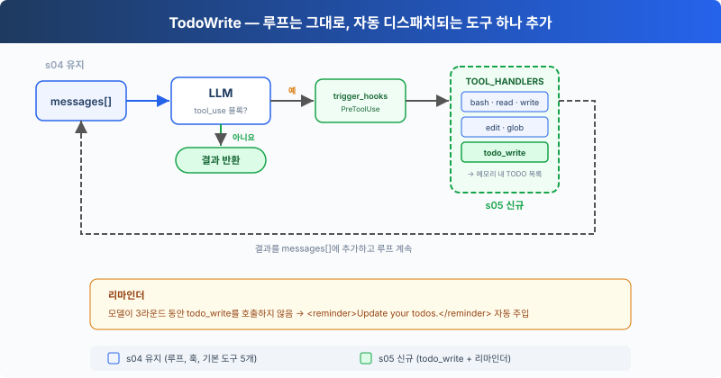

# s05: TodoWrite — 계획 없는 에이전트는 길을 잃습니다

[English](README.md) · [中文](README.zh.md) · [日本語](README.ja.md) · [한국어](README.ko.md)

s01 → s02 → s03 → s04 → `s05` → [s06](../s06_subagent/) → s07 → ... → s16 → s17

> *"An agent without a plan goes wherever the wind blows"* — 단계를 먼저 나열하고 나서 실행합니다. 그러면 복잡한 작업에서도 단계를 빠뜨릴 일이 줄어듭니다.
>
> **하네스 레이어**: 계획 — 에이전트가 행동하기 전에 먼저 생각하게 합니다.

---

## 문제

에이전트에게 복잡한 작업을 맡깁니다. "모든 Python 파일 이름을 snake_case로 바꾸고, 테스트를 실행하고, 실패한 테스트를 고쳐 줘."

에이전트는 작업을 시작해 파일 3개의 이름을 바꾸고, 테스트를 실행해 실패 2건을 발견하고, 수정에 들어갑니다. 그런데 고치는 사이에 원래 목표가 "snake_case로 이름 바꾸기"였다는 사실을 잊어버립니다. 테스트 실패에 주의를 모두 빼앗겼기 때문입니다.

대화가 길어질수록 상황은 더 나빠집니다. 도구 결과가 계속 컨텍스트를 채우면서 시스템 프롬프트의 영향력이 옅어집니다. 10단계짜리 리팩터링이라면 1~3단계를 마친 뒤부터 에이전트가 즉흥적으로 움직이기 시작합니다. 4~10단계가 주의 범위 밖으로 밀려났기 때문입니다.

---

## 해결 방법



S05는 S04의 도구 디스패치, 권한, 훅을 그대로 두고 `todo_write`와 리마인더 카운터를 더합니다. `todo_write`는 계획 상태만 갱신하고, 실제 작업은 기존 도구가 계속 맡습니다.

새 도구도 같은 `TOOL_HANDLERS[block.name]` 디스패치 경로를 탑니다. `todo_write` 없이 도구 사용 라운드가 세 번 연속 이어지면, 하네스는 그 라운드의 도구 결과에 리마인더를 덧붙입니다.

---

## 동작 방식

**TodoManager**는 메모리 안의 목록을 관리하고, 갱신 내용을 검증하고, 모델에 돌려줄 상태를 렌더링합니다. `run_todo_write`는 그 상태를 터미널에도 출력합니다.

```python
class TodoManager:
    def __init__(self):
        self.items = []

    def update(self, todos: list | str) -> str:
        # Parse and validate before replacing the current list.
        validated = []
        ...
        self.items = validated
        return self.render()

    def render(self) -> str:
        # [ ] pending, [>] in progress, [x] completed
        ...


TODO = TodoManager()

def run_todo_write(todos: list | str) -> str:
    output = TODO.update(todos)
    print(output)
    return output
```

한 번 갱신할 때 항목은 최대 20개까지 담을 수 있고, 각 항목에는 비어 있지 않은 `content`가 있어야 하며, `in_progress` 상태인 항목은 하나만 둘 수 있습니다. 문자열 입력은 JSON이나 Python 리스트 표현을 받으며, 이때 `eval`은 쓰지 않습니다.

도구 정의는 다른 5개 도구와 함께 디스패치 맵에 들어갑니다.

```python
TOOLS = [
    {"name": "bash",       ...},
    {"name": "read_file",  ...},
    {"name": "write_file", ...},
    {"name": "edit_file",  ...},
    {"name": "glob",       ...},
    # s05: new entry
    {"name": "todo_write", "description": "Create and manage a task list ...",
     "input_schema": {
         "type": "object",
         "properties": {
             "todos": {
                 "type": "array",
                 "items": {
                     "type": "object",
                     "properties": {
                         "content": {"type": "string"},
                         "status": {"type": "string", "enum": ["pending", "in_progress", "completed"]},
                     },
                 },
             },
         },
     },
    },
]

TOOL_HANDLERS["todo_write"] = run_todo_write
```

**리마인더**: `todo_write` 없이 도구 사용 라운드가 세 번 이어지면, 세 번째 라운드의 결과에 리마인더를 덧붙이고 카운터를 초기화합니다.

```python
rounds_since_todo = 0 if used_todo else rounds_since_todo + 1
if rounds_since_todo >= 3:
    results.append({
        "type": "text",
        "text": "<reminder>Update your todos.</reminder>",
    })
    rounds_since_todo = 0
```

에이전트가 작업을 받았을 때의 일반적인 흐름은 다음과 같습니다. 먼저 `todo_write`를 호출해 모든 단계를 나열합니다(모두 `pending`) → 한 단계를 골라 `in_progress`로 바꿉니다 → 끝나면 `completed`로 바꿉니다 → 다음 `pending` 단계를 확인합니다 → 계속합니다.

**핵심 통찰**: todo_write는 에이전트에게 **실행 능력**을 더해 주지 않습니다. 더해 주는 것은 **계획 능력**입니다.

---

## s04와 달라진 점

| 구성 요소 | 이전 (s04) | 이후 (s05) |
|-----------|-------------|-------------|
| 도구 수 | 5개 (bash, read, write, edit, glob) | 6개 (+todo_write) |
| 계획 | 없음 | 상태를 가진 TODO 목록 + 리마인더 |
| SYSTEM 프롬프트 | 일반 프롬프트 | "실행 전에 계획하라"는 지침 추가 |
| 루프 | 도구 디스패치와 훅 | 같은 디스패치 경로에 rounds_since_todo와 리마인더 주입 추가 |

---

## 직접 해 보기

```sh
cd learn-claude-code
python s05_todo_write/code.py
```

다음 프롬프트를 입력해 보세요.

1. `Refactor s05_todo_write/example/hello.py: add type hints, docstrings, and a main guard` (먼저 3단계를 나열한 뒤 실행해야 합니다)
2. `Create a Python package under s05_todo_write/example/demo_pkg with __init__.py, utils.py, and tests/test_utils.py`
3. `Review Python files under s05_todo_write/example and fix any style issues`

살펴볼 점: 첫 번째 도구 호출이 `todo_write`였나요? TODO 단계는 몇 개나 나열됐나요? 실행하는 동안 상태가 `pending`에서 `in_progress` / `completed`로 바뀌었나요?

---

## 다음 장

이제 에이전트는 계획을 세울 수 있습니다. 하지만 "인증 모듈 전체를 리팩터링해 줘"처럼 작업이 너무 크면 TODO 목록만으로는 부족합니다. 이런 작업은 그 자체로 수십 개의 하위 작업 묶음이어서, 대화 하나의 컨텍스트 안에서는 묻혀 버립니다.

→ s06 서브에이전트: 큰 작업을 하위 작업으로 나누고, 각 하위 작업을 깨끗한 자체 컨텍스트를 가진 독립 에이전트에게 맡깁니다. 서로 오염되지 않습니다.
