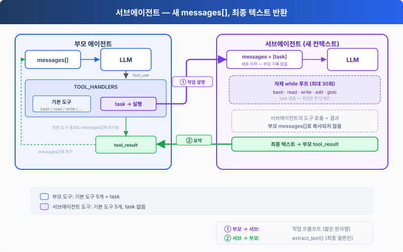

# s06: 서브에이전트 — 하위 작업에 별도의 컨텍스트를 줍니다

[English](README.md) · [中文](README.zh.md) · [日本語](README.ja.md) · [한국어](README.ko.md)

s01 → s02 → s03 → s04 → s05 → `s06` → [s07](../s07_skill_loading/) → s08 → ... → s16 → s17

> 서브에이전트는 새 `messages[]`로 시작합니다. 최종 텍스트는 부모에게 돌아가지만, 중간 대화는 돌아가지 않습니다.
>
> **하네스 레이어**: 위임 — 집중해야 할 작업을 별도의 대화 컨텍스트에서 실행합니다.

---

## 문제

에이전트가 버그를 고치고 있습니다. 호출 체인을 추적하려고 여러 파일을 읽는데, 그때마다 도구 호출과 결과가 부모의 `messages[]`에 그대로 남습니다. 호출 체인을 파악하고 나면 이 중간 내용은 대부분 더 필요 없지만, 여전히 컨텍스트를 차지합니다.

---

## 해결 방법



`task`를 호출하면 새 `messages[]`를 가진 중첩 에이전트 루프가 동기적으로 실행됩니다. 그 루프가 끝나면 최종 텍스트가 부모 대화의 도구 결과가 됩니다.

이것은 메시지 격리이지, 프로세스나 파일 시스템 격리가 아닙니다. 부모와 서브에이전트는 같은 Python 프로세스에서 실행되고 `WORKDIR`를 공유하므로, 파일 쓰기와 명령은 여전히 같은 작업 공간에 영향을 줍니다. 서브에이전트는 기본 도구 5개를 갖지만 `task`는 없으며, 서브에이전트의 도구 호출에도 부모와 같은 권한 훅과 라이프사이클 훅이 적용됩니다.

---

## 동작 방식

**run_subagent**는 새 메시지 목록을 만들고, 중첩 루프를 실행한 뒤, 최종 텍스트를 돌려줍니다.

```python
SUB_TOOLS = list(BASE_TOOLS)  # no task tool

def run_subagent(prompt: str) -> str:
    messages = [{"role": "user", "content": prompt}]

    for _ in range(30):
        response = client.messages.create(
            model=MODEL, system=SUB_SYSTEM,
            messages=messages, tools=SUB_TOOLS, max_tokens=8000,
        )
        messages.append({"role": "assistant", "content": response.content})
        tool_calls = [
            block for block in response.content if block.type == "tool_use"
        ]
        if not tool_calls:
            return extract_text(response.content) or "(no summary)"

        results = []
        for block in tool_calls:
            output = execute_tool(block, SUB_HANDLERS)
            results.append({... "content": output})
        messages.append({"role": "user", "content": results})

    return "Subagent stopped after 30 turns without a final answer."
```

메인 에이전트는 다른 도구와 똑같이 이 함수를 호출합니다.

```python
TASK_TOOL = {
    "name": "task",
    "description": "Run a subagent with fresh conversation context and return its final text.",
    "input_schema": {
        "type": "object",
        "properties": {"prompt": {"type": "string"}},
        "required": ["prompt"],
    },
}

TOOLS = [*BASE_TOOLS, TASK_TOOL]
TOOL_HANDLERS = {**BASE_HANDLERS, "task": run_subagent}
```

경계는 다음과 같습니다.

| 결정 | 선택 | 이유 |
|----------|--------|--------|
| 대화 | 새 `messages[]` | 부모의 기록을 서브에이전트로 복사하지 않음 |
| 실행 | 같은 프로세스와 `WORKDIR` | 파일 시스템 변경이 두 루프 모두에 보임 |
| 반환값 | 최종 텍스트만 | 자식의 도구 호출과 결과를 부모 메시지로 복사하지 않음 |
| 위임 깊이 | `SUB_TOOLS`에 `task` 없음 | 이 장에서는 위임을 한 단계만 허용함 |
| 도구 정책 | 공유 훅 | 부모와 서브에이전트가 같은 권한 검사를 거침 |

부모는 다른 도구와 같은 핸들러 맵으로 `task`를 디스패치합니다. 서브에이전트는 `SUB_SYSTEM`, `SUB_TOOLS`, 그리고 자신만의 로컬 `messages` 목록을 씁니다.

---

## 직접 해 보기

```sh
cd learn-claude-code
python s06_subagent/code.py
```

다음 프롬프트를 입력해 보세요.

1. `Use a subtask to find what testing framework this project uses` (서브에이전트가 파일을 읽고, 메인 에이전트는 결론만 받습니다)
2. `Delegate: read all .py files in agents/ and summarize what each one does`
3. `Use a task to create s06_subagent/example/string_tools.py with a slugify(text: str) function, then verify it from the parent agent`

살펴볼 점: `[Subagent started]` / `[Subagent done]`이 나타나나요? 서브에이전트의 도구 호출이 `[sub] ...` 형태로 출력되나요? 부모는 `task`가 돌려준 최종 텍스트만 가지고 작업을 이어 가나요?

---

## 다음 장

이제 에이전트는 작업을 나눌 수 있습니다. 하지만 작업마다 필요한 지식이 다릅니다. 프런트엔드 컴포넌트를 고치려면 React 규칙을 알아야 하고, SQL을 쓰려면 테이블 스키마를 알아야 합니다. 이런 지식을 모두 시스템 프롬프트에 밀어 넣으면 컨텍스트가 감당할 수 없을 만큼 커집니다.

→ s07 스킬 로딩: 문서를 시스템 프롬프트에 쌓아 두는 대신 필요할 때 스킬을 주입합니다. 필요할 때만, 파일을 읽듯 자연스럽게 불러옵니다.
