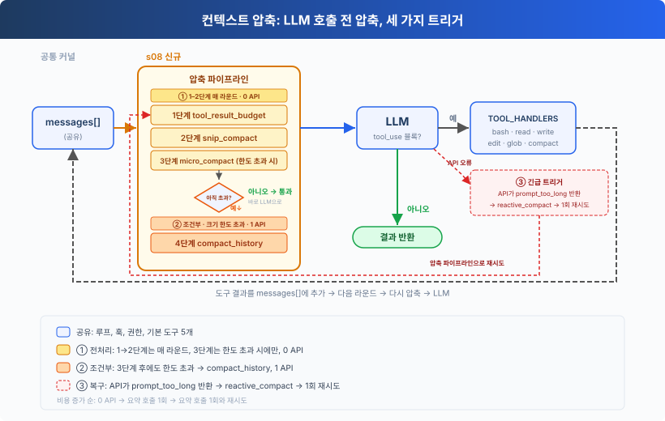
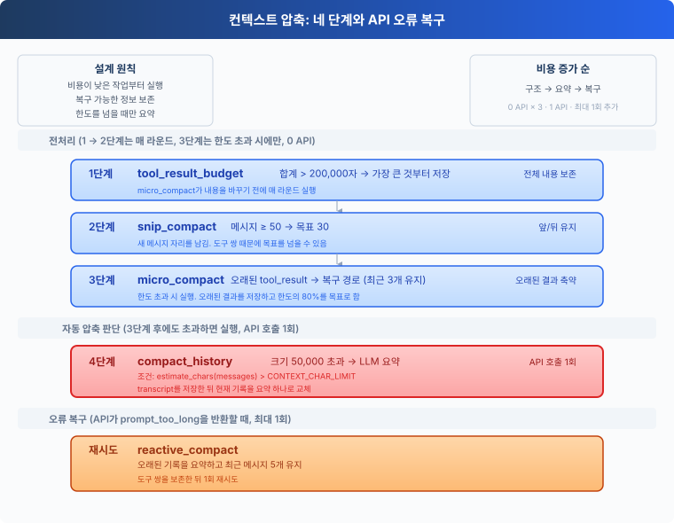
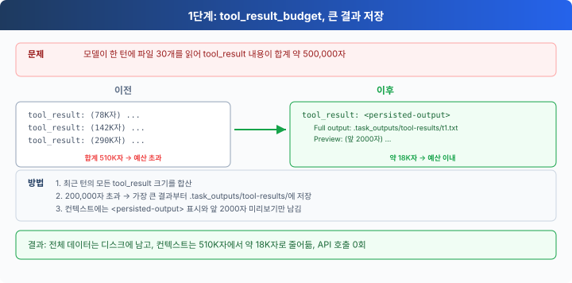
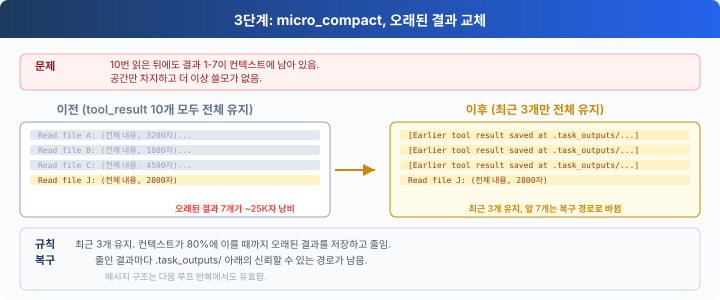
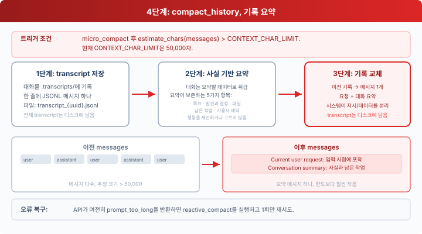

# s08: 컨텍스트 압축 — 컨텍스트가 차기 전에 공간을 확보합니다

[English](README.md) · [中文](README.zh.md) · [日本語](README.ja.md) · [한국어](README.ko.md)

s01 → s02 → s03 → s04 → s05 → s06 → s07 → `s08` → [s09](../s09_memory/) → s10 → ... → s16 → s17

> *"Context will fill up, so the Harness needs a way to make room."* 네 단계가 비용이 낮은 것부터 높은 것 순으로 실행됩니다.
>
> **하네스 레이어**: 압축 — 긴 작업 내내 제한된 컨텍스트를 쓸모 있게 유지합니다.


에이전트가 일하는 동안 읽은 파일, 명령 결과, 모델 응답이 모두 `messages`에 남습니다. 이 기록은 결국 모델의 컨텍스트 윈도를 넘어섭니다.

이 장에서는 네 단계로 된 압축 파이프라인을 추가합니다. 먼저 다시 복구할 수 있는 도구 출력을 줄이고, 그것만으로 부족할 때만 기록을 요약합니다.




## 컨텍스트 이해하기

컨텍스트 윈도를 모델이 지금 쓰고 있는 메모장이라고 생각해 보세요. 사용자 메시지, 모델 응답, `tool_use` 블록과 `tool_result` 블록이 순서대로 여기에 적힙니다. 모델은 작업을 이어 갈 때마다 이 내용을 다시 읽습니다.

메모장의 크기는 정해져 있습니다. 요청이 이 크기를 넘으면 API가 `prompt is too long`으로 호출을 거부합니다. 코딩 작업에서는 대개 도구 결과가 공간을 가장 많이 차지합니다.

- 긴 파일을 읽으면 그 내용이 컨텍스트에 들어갑니다.
- 테스트 로그와 빌드 로그는 한 번에 수십 KB를 더할 수 있습니다.
- 여러 파일을 검색하면 결과가 계속 쌓입니다.

작업이 이어질수록 `messages`는 계속 커집니다. 압축은 현재 목표, 사용자 제약, 진행 중인 작업을 지키면서 이 증가를 억제합니다.


## 도구 결과를 먼저 다루는 이유

전체 기록을 요약하면 빠르게 줄일 수 있지만, 요약할 때마다 세부 내용이 조금씩 사라지고 모델 호출도 한 번 더 필요합니다.

첫 번째 대상으로는 도구 결과가 더 낫습니다.

1. 큰 파일 결과는 디스크에 저장해 두었다가 나중에 다시 읽을 수 있습니다.
2. 오래된 명령은 다시 실행할 수 있습니다.
3. 대개 최근 결과가 현재 단계와 더 관련이 깊습니다.
4. 텍스트를 잘라 내거나 구조를 고치는 일에는 모델을 호출하지 않습니다.

그래서 파이프라인은 정보 손실과 비용이 커지는 순서를 따릅니다. 저장하고, 잘라 내고, 오래된 결과를 바꾸고, 마지막에 요약합니다.




## 1단계: tool_result_budget

모델 응답 하나가 여러 도구를 한 번에 요청할 수 있습니다. 완료된 `tool_result` 블록은 마지막 사용자 메시지에 함께 적힙니다. 이 내용을 합친 길이가 `200_000`자를 넘으면 `tool_result_budget`이 가장 큰 결과부터 처리합니다.

`LARGE_RESULT_CHAR_LIMIT = 30000`을 넘는 결과는 전체 내용을 다음 위치에 씁니다.

```text
.task_outputs/tool-results/<tool_use_id>.txt
```

컨텍스트에는 파일 경로와 2,000자 미리보기만 남습니다.



핵심 루프는 크기가 큰 순서대로 결과를 저장합니다.

```python
blocks = [block for block in content
          if isinstance(block, dict)
          and block.get("type") == "tool_result"]
total = sum(len(str(block.get("content", ""))) for block in blocks)

ranked = sorted(
    blocks,
    key=lambda block: len(str(block.get("content", ""))),
    reverse=True,
)
for block in ranked:
    if total <= max_chars:
        break
    content = str(block.get("content", ""))
    if len(content) <= self.LARGE_RESULT_CHAR_LIMIT:
        continue
    block["content"] = self.persist_large_output(
        block.get("tool_use_id", "unknown"), content)
    total = sum(len(str(item.get("content", ""))) for item in blocks)
```

이 단계는 가장 최근 도구 결과 묶음만 살펴봅니다. 전체 출력은 저장된 경로에 그대로 남아 있으므로, 가장 먼저 실행해도 가장 안전한 작업이 바로 저장입니다.


## 2단계: snip_compact

기록이 `trigger_messages`(기본값 50)에 이르면 `snip_compact`는 전체 기록을 `.transcripts/`에 쓴 뒤 `target_messages`(기본값 30)에 맞춰 잘라 냅니다. 처음 3개 메시지, 보관 표시 하나, 최근 26개 메시지만 남깁니다. 표시에는 몇 개의 메시지를 뺐는지와 전체 transcript의 위치가 적힙니다. 트리거 개수와 목표 개수를 따로 두면 새 메시지가 들어올 자리가 생기므로, 이후 모델을 호출할 때마다 보관 파일을 다시 쓰지 않아도 됩니다. 대신 컨텍스트에 바로 남는 최근 메시지는 줄어듭니다. 오래된 내용은 transcript에서 계속 확인할 수 있습니다.

`5 <= target_messages < trigger_messages`를 지켜야 합니다. 목표 개수에는 표시가 포함되고, 처음 3개 뒤에 최근 메시지가 적어도 하나는 남아야 하기 때문입니다.

```python
if len(messages) < trigger_messages:
    return messages
head_end = 3
tail_start = len(messages) - (target_messages - head_end - 1)

if self.has_tool_use(messages[head_end - 1]):
    while (head_end < tail_start
           and self.is_tool_result(messages[head_end])):
        head_end += 1

if (tail_start > 0
        and self.is_tool_result(messages[tail_start])
        and self.has_tool_use(messages[tail_start - 1])):
    tail_start -= 1

transcript = self.write_transcript(messages)
marker = {"role": "user", "content":
          f"[{tail_start - head_end} messages archived at {transcript}]"}
messages = [*messages[:head_end], marker, *messages[tail_start:]]
```

자르는 지점은 `assistant(tool_use)`와 `user(tool_result)` 쌍을 모두 지키므로, 남는 개수가 목표보다 조금 많을 수 있습니다. 짝이 없는 결과에는 대응하는 도구 호출이 없어서 다음 API 요청이 잘못된 요청이 되기 때문입니다.

도구 호출이 반복되면 현재 요청이 보관되는 중간 구간으로 밀려날 수 있습니다. 실제로 잘라 낸 뒤에는 `prepare`가 원래 사용자 메시지나 기존 `Current user request` 표시가 아직 보이는지 확인합니다. 둘 다 없으면 계속하기 전에 `active_request`를 한 번 덧붙입니다.

이 단계는 메시지 개수를 조절합니다. 남은 메시지 안의 도구 결과는 여전히 길 수 있습니다.


## 3단계: micro_compact

앞의 두 단계를 마친 뒤 `prepare`는 남은 컨텍스트 크기를 추정하고, 그 값이 `CONTEXT_CHAR_LIMIT`를 넘을 때만 `micro_compact`를 실행합니다. `micro_compact`는 모델이 이미 읽은 결과 가운데 최근 3개는 그대로 두고, 그보다 오래된 120자 넘는 결과를 컨텍스트가 한도의 80%에 가까워질 때까지 줄입니다. 오래된 결과를 바꾸기 전에 전체 내용을 디스크에 쓰므로, 바뀐 결과마다 복구 경로가 남습니다.



```python
unseen = self.unseen_tool_result_positions(messages)
consumed = [entry for entry in results if entry[:2] not in unseen]

for _, _, block in consumed[:-self.KEEP_RECENT_RESULTS]:
    if self.estimate_chars(messages) <= target_chars:
        break
    content = str(block.get("content", ""))
    if len(content) <= 120:
        continue
    saved_path = self.persisted_output_path(content)
    if not saved_path:
        saved_path = self.save_output(block["tool_use_id"], content)
    block["content"] = f"[Earlier tool result saved at {saved_path}]"
```

새 결과는 보통 모델이 읽기 전까지 그대로 남습니다. 모델이 아직 보지 않은 묶음 하나만으로도 컨텍스트에 비해 너무 크면, `fit_tool_results`가 그 안에서 가장 큰 결과를 저장하고 1,000자 미리보기와 전체 출력 경로를 남깁니다. 이렇게 하면 모델이 새 결과를 살펴보기도 전에 전체 기록을 요약하는 일을 피할 수 있습니다.

앞의 두 단계는 매 라운드 실행됩니다. 3단계는 컨텍스트가 한도를 넘을 때만 실행됩니다. 세 단계 모두 결정적이고 복구할 수 있는 텍스트·구조 작업이며, API 호출을 늘리지 않습니다.


## 4단계: compact_history

`micro_compact`와 `fit_tool_results`를 거친 뒤 코드는 `estimate_chars(messages)`로 컨텍스트를 다시 추정합니다.

```python
CONTEXT_CHAR_LIMIT = 50000

def estimate_chars(messages):
    return len(json.dumps(messages, default=str, ensure_ascii=False))
```

그래도 `CONTEXT_CHAR_LIMIT`를 넘으면 `compact_history`가 네 가지 일을 합니다.

1. 전체 메시지 기록을 `.transcripts/`에 씁니다.
2. 모델에게 사실에 기반한 상태 요약을 요청합니다.
3. 입력 경계에서 붙잡아 둔 요청을 요약과 따로 보관합니다.
4. 현재 기록을 `[Compacted]` 메시지 하나로 바꿉니다.



```python
def compact_history(messages, active_request):
    transcript = self.write_transcript(messages)
    print(f"[transcript saved: {transcript}]")
    summary = self.summarize_history(messages)
    return [self.summary_message(
        "Compacted", active_request, summary, transcript)]
```

요약 호출은 기록 속 지시를 실행하지 말고 목표, 파일, 결정 사항, 남은 작업, 사용자 제약을 적어 달라고 모델에게 요청합니다. 도구 결과도 `role=user`를 쓰기 때문에 CLI는 `active_request`를 에이전트 루프에 따로 넘깁니다. 압축된 메시지는 이 값을 `Current user request` 아래에 두고, 요약은 `Conversation summary` 아래에 넣으며, 전체 transcript 경로도 함께 담습니다.

이 장에서는 문자 수를 트리거로 쓰며, 관련된 한도도 모두 같은 단위를 씁니다.


## 순서가 고정된 이유

파이프라인은 다음 순서를 따르고, 꼭 필요할 때만 정보가 손실되는 요약 단계로 들어갑니다.

```python
messages = self.tool_result_budget(messages)
before_snip = messages
messages = self.snip_compact(messages)
active_request_marker = (
    f"Current user request:\n{active_request}\n\n"
    "Conversation summary (reference only):"
)
if (messages is not before_snip
        and not any(
            message.get("role") == "user"
            and isinstance(message.get("content"), str)
            and (message["content"] == active_request
                 or active_request_marker in message["content"])
            for message in messages)):
    messages.append({"role": "user", "content": active_request})
if self.estimate_chars(messages) > self.CONTEXT_CHAR_LIMIT:
    target = int(self.CONTEXT_CHAR_LIMIT * 0.8)
    messages = self.micro_compact(messages, target)
    if self.estimate_chars(messages) > self.CONTEXT_CHAR_LIMIT:
        messages = self.fit_tool_results(messages, target)
    if self.estimate_chars(messages) > self.CONTEXT_CHAR_LIMIT:
        messages = self.compact_history(messages, active_request)
```

이 순서는 두 가지 조건을 만족합니다.

1. 1단계와 2단계는 매 라운드 실행됩니다. 3단계는 한도를 넘을 때만 실행되고, API 요청을 늘리는 것은 4단계뿐입니다.
2. 줄어든 도구 결과는 모두 `.task_outputs/tool-results/` 안에 믿을 수 있는 경로를 남깁니다. 그러고도 넘치는 부분만 모델이 만드는 기록 요약으로 넘어갑니다.

그래서 매 라운드는 비용이 가장 낮고 정보를 가장 쉽게 복구할 수 있는 작업부터 시작합니다.


## API 거부에서 복구하기

문자 수로는 모델이 쓰는 토큰을 추정할 수밖에 없습니다. 그래서 API가 여전히 `prompt is too long`을 반환할 수 있습니다. `reactive_compact`는 transcript를 저장하고, 오래된 기록을 요약하고, 최근 메시지 5개를 남깁니다.

```python
tail_start = max(0, len(messages) - self.KEEP_RECENT_MESSAGES)
if (tail_start > 0
        and self.is_tool_result(messages[tail_start])
        and self.has_tool_use(messages[tail_start - 1])):
    tail_start -= 1

old_history = messages[:tail_start] if tail_start else messages
summary = self.summarize_history(old_history)
message = self.summary_message(
    "Reactive compact", active_request, summary, transcript)
messages = [message, *messages[tail_start:]] if tail_start else [message]
```

여기서도 자르는 지점이 도구 호출과 그 결과를 갈라놓지 않으며, `active_request`가 현재 사용자 요청을 명시적으로 전달합니다. `MAX_REACTIVE_RETRIES = 1`이므로 복구는 한 번만 시도합니다. 컨텍스트 길이 오류가 두 번째로 나면 호출자에게 그대로 던집니다.


## 에이전트 루프에 넣기

```python
def agent_loop(messages, active_request):
    while True:
        messages[:] = COMPACTOR.prepare(messages, active_request)

        try:
            response = client.messages.create(
                model=MODEL, system=SYSTEM, messages=messages,
                tools=TOOLS, max_tokens=8000)
            reactive_retries = 0
        except Exception as error:
            message = str(error).lower()
            too_long = ("prompt_too_long" in message
                        or "prompt is too long" in message
                        or "too many tokens" in message)
            if too_long and reactive_retries < MAX_REACTIVE_RETRIES:
                messages[:] = COMPACTOR.reactive_compact(
                    messages, active_request)
                reactive_retries += 1
                continue
            raise
```

모든 모델 호출이 같은 파이프라인을 거칩니다. CLI는 `query`를 덧붙인 뒤 `agent_loop(history, query)`를 호출하고, `prepare`는 실제로 잘라 내는 과정에서 보이던 사본이 모두 사라졌을 때만 `active_request`를 되살립니다. 그래서 압축을 여러 번 해도 현재 요청을 잃지 않습니다. 코드는 `micro_compact`를 거친 뒤에도 컨텍스트가 한도를 넘거나 API가 요청을 거부할 때만 요약을 요청합니다.


## compact 도구

자동 임계값은 컨텍스트가 얼마나 큰지만 압니다. 모델은 한 단계를 마치고 다음 단계에 요약만 있으면 될 때 직접 `compact`를 호출할 수도 있습니다.

```python
{"name": "compact",
 "description": "Summarize earlier conversation to free context space."}
```

응답 하나가 파일을 쓴 다음 압축하는 것처럼 여러 도구를 한 번에 요청할 수 있습니다. 하네스는 먼저 묶음 전체를 실행하고 모든 `tool_use`마다 `tool_result`를 하나씩 덧붙입니다. 요약은 그 턴이 끝난 뒤에만 합니다.

```python
tool_calls = [
    block for block in response.content if block.type == "tool_use"
]
results = []
compact_requested = False

for block in tool_calls:
    if block.name == "compact":
        output = "Compaction requested after this tool batch."
        compact_requested = True
    else:
        output = execute_tool(block)
    results.append({"type": "tool_result", "tool_use_id": block.id,
                    "content": output})

messages.append({"role": "user", "content": results})

if compact_requested:
    messages[:] = COMPACTOR.compact_history(messages, active_request)
```

이렇게 하면 짝 없는 도구 결과가 남지 않습니다. 파일 쓰기 같은 부수 효과의 기록도 압축 전에 남으므로, 모델이 같은 일을 반복하지 않습니다.


## 이 장에서 추가한 것

| 구성 요소 | 공통 실행 루프 | s08에서 추가한 것 |
| --- | --- | --- |
| 에이전트 루프 | 모델을 호출하고, 도구를 실행하고, 결과를 덧붙임 | 모델을 호출할 때마다 먼저 `COMPACTOR.prepare()`를 실행함 |
| 훅 | 권한 검사, 도구 로그, 결과 처리 | 같은 도구 실행 진입점을 유지함 |
| 컨텍스트 | `messages`에 덧붙임 | 큰 결과를 저장하고, 오래된 기록을 보관하고, 요약하고, 길이 오류가 나면 한 번 재시도함 |
| 도구 | 기본 도구 5개 | `compact`를 더해 모두 6개 |

> **s09와의 경계:** s08은 현재 세션의 제한된 컨텍스트를 관리하며, 복구할 수 있는 세부 내용은 버릴 수 있습니다. s09는 압축과 이후 세션을 거쳐도 남아야 하는 정보를 저장합니다.


## 직접 해 보기

```bash
cd learn-claude-code
python s08_context_compact/code.py
```

### 실험 1: 이전 결과 바꾸기

```text
Read the README.md files from s01_agent_loop through s05_todo_write.
Compare their top-level headings and summarize the naming pattern.
```

이 작업은 파일 결과를 적어도 5개 만듭니다. 새 결과는 보통 모델이 한 번 볼 때까지 그대로 남습니다. 아직 보지 않은 결과가 너무 크면 대신 미리보기와 복구 경로가 남습니다. 이후 턴에서는 모델이 읽은 결과 가운데 최근 3개만 그대로 남고, 그보다 오래된 긴 결과는 `[Earlier tool result saved at ...]` 참조로 바뀝니다.

### 실험 2: 큰 결과 저장하기

```text
Analyze the structure of web/src/data/generated/docs.json
and explain the main fields in one lesson record.
```

파일이 턴당 예산을 넘어도 작업은 끝까지 진행되고, 전체 결과는 `.task_outputs/tool-results/` 아래에 나타납니다.

### 실험 3: 자동 요약 일으키기

```text
Compare s08_context_compact/code.py with s09_memory/code.py.
Explain how they manage current context and persistent memory.
```

파일 결과 때문에 `estimate_chars(messages)`가 50000을 넘으면 터미널에 `[auto compact]`와 transcript 경로가 출력됩니다. 다음 호출은 `[Compacted]` 요약에서 이어집니다.

`.transcripts/`와 `.task_outputs/tool-results/`를 열어 보관된 기록과 저장된 큰 출력을 확인해 보세요.


## 다음 장

컨텍스트 압축 덕분에 에이전트는 제한된 윈도 안에서 긴 작업을 이어 갈 수 있습니다. 압축과 이후 세션을 거쳐도 남아야 하는 정보에는 별도의 영구 메모리 시스템이 필요합니다.

s09 메모리에서는 메모리 쓰기, 검색, 통합을 추가합니다.
