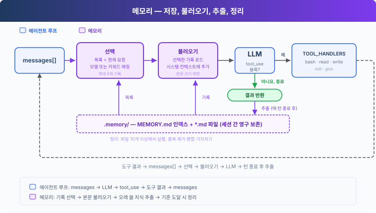
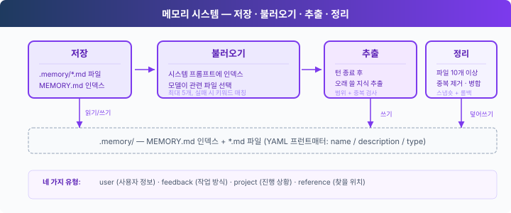

# s09: 메모리 — 세션이 바뀌어도 쓸모 있는 지식을 남깁니다

[English](README.md) · [中文](README.zh.md) · [日本語](README.ja.md) · [한국어](README.ko.md)

s01 → ... → s07 → s08 → `s09` → [s10](../s10_task_system/) → s11 → ... → s16 → s17
> *"Keep information that later tasks will need."* 파일 저장소 + 인덱스 + 관련성 선택 + 필요할 때 불러오기.
>
> **하네스 레이어**: 메모리는 다시 쓸 지식을 대화 밖에 저장해 두고, 관련 있는 작업에서 불러옵니다.

---

## 문제

에이전트가 새 세션을 시작하면 `messages`에는 이전 대화가 없습니다. 하지만 이전 세션에서 얻은 코딩 취향, 프로젝트 사실, 디버깅 단서는 여전히 중요할 수 있습니다. 영구 저장소가 없으면 사용자가 이를 다시 알려 줘야 합니다.

대화 기록 전체를 보관해 두면 기록 보관소 역할은 합니다. 하지만 요청할 때마다 전부 보내는 방식은 규모가 커지면 버티지 못합니다. 대화는 계속 길어지고, 쓸모 있는 정보는 찾기 어려워지며, 오래된 사실은 더 이상 맞지 않을 수 있습니다. 메모리는 세션을 넘어 남길 가치가 있는 것이 무엇인지, 그리고 지금 작업에 필요한 기록이 무엇인지 정해야 합니다.



---

## 왜 전부 시스템 프롬프트에 넣지 않을까요?

가장 단순한 방법은 취향과 프로젝트 사실을 파일 하나에 적고, 그 파일 전체를 시스템 프롬프트에 넣는 것입니다. 정보는 기억되지만, LLM을 호출할 때마다 전부 다시 보내야 합니다. 저장소가 커질수록 관련 없는 내용이 입력 토큰과 컨텍스트 공간을 더 많이 차지합니다.

s07에서는 더 나은 읽기 방식을 보았습니다. 짧은 인덱스를 늘 곁에 두고, 전체 내용은 필요할 때만 불러오는 것입니다. 스킬은 사람이 작성하고 읽기만 합니다. 메모리는 에이전트가 대화에서 정보를 뽑아내 이후 작업에서 다시 쓸 수 있게 합니다.

그래서 이 장에는 저장, 불러오기, 추출, 정리라는 네 부분이 필요합니다.



---

## 저장: 기록 하나에 파일 하나

메모리 하나는 `.memory/` 아래의 Markdown 파일 하나입니다. YAML 프런트매터에 `name`, `description`, `type`을 저장합니다.

```markdown
---
name: user-preference-tabs
description: User prefers tabs for indentation
type: user
---

User prefers using tabs, not spaces, for indentation.
```

메모리 유형은 네 가지입니다.

| 유형 | 저장하는 내용 | 예시 |
|------|----------------|---------|
| user | 오래 유지되는 사용자 취향 | "들여쓰기는 탭으로" |
| feedback | 계속 쓸모 있는 지침 | "데이터베이스를 mock하지 말 것" |
| project | 잘 바뀌지 않는 프로젝트 사실 | "인증 재작성은 컴플라이언스 때문에 진행된다" |
| reference | 외부 위치나 찾아볼 단서 | "파이프라인 이슈는 Linear INGEST에서 관리한다" |

`MEMORY.md`는 인덱스이며, 메모리 파일마다 한 줄씩 적힙니다. 기록을 쓴 뒤에는 `rebuild_memory_index()`가 파일들로부터 인덱스를 다시 만듭니다.

```python
def write_memory_file(name, mem_type, description, body):
    path = MEMORY_DIR / f"{memory_slug(name)}.md"
    path.write_text(
        memory_document(name, mem_type, description, body), encoding="utf-8"
    )
    rebuild_memory_index()
    return path
```

인덱스는 선택에 쓰이고, 전체 내용은 개별 파일에 그대로 남습니다.

---

## 불러오기: 먼저 고르고, 그다음 전체 기록을 읽습니다

사용자 요청이 시작되면 `select_relevant_memories()`가 최근 사용자 텍스트와 메모리 목록을 가벼운 모델 호출에 보냅니다. 이 호출은 관련 있는 기록을 최대 다섯 개까지 고릅니다.

```python
prompt = (
    "Select memory records that are relevant to the current user request. "
    "Return only a JSON array of catalog indices, such as [0, 2]. "
    "Return [] when none are relevant."
)
```

모델 호출이나 JSON 파싱이 실패하면 키워드 매칭으로 대신합니다. 선택이 끝난 뒤에야 `load_memories()`가 해당 파일을 읽으며, 불러오는 텍스트의 총량에는 제한이 있습니다.

```python
relevant_memories = load_memories(messages)
system = build_system(relevant_memories)
```

`build_system()`은 불러온 내용이 배경지식일 뿐 새로운 사용자 명령이 아니라고 밝힙니다. 메모리와 충돌하면 현재 요청이 우선합니다. 덕분에 에이전트는 오래된 정보를 활용하면서도, 오래된 기록이 사용자 대신 지시를 내리게 두지 않습니다.

---

## 추출: 턴이 끝난 뒤 다시 쓸 정보를 저장합니다

사용자가 늘 "이거 기억해 둬"라고 말하지는 않습니다. 에이전트가 현재 응답을 마치면 `extract_memories()`가 대화를 살펴보고, 나중에 도움이 될 만한 정보만 남깁니다.

```python
tool_calls = [
    block for block in response.content if block.type == "tool_use"
]
if not tool_calls:
    force = trigger_hooks("Stop", messages)
    if force:
        messages.append({"role": "user", "content": force})
        continue
    if extract_memories(messages):
        consolidate_memories()
    return
```

모델이 돌려주는 것은 후보이지, 자동으로 디스크에 저장해도 되는 기록이 아닙니다. 후보마다 `scope`가 붙습니다. `persistent`만 그 정보가 이후 세션까지 살아남아야 한다는 뜻입니다. `current_task`는 일회성 명령, 임시 경로, 임시 제한을 가리킵니다.

마지막 허용 여부는 `should_store_memory()`가 확인합니다. 불완전한 후보, 현재 세션이나 작업을 가리키는 표현, 기존 기록과 중복되는 후보는 거부합니다. 예를 들어 "이번 세션에서는 파일을 만들지 마"는 지금 하는 작업을 제한하는 말이므로, 다음 세션까지 효력이 남으면 안 됩니다.

---

## 정리: 중복되거나 낡은 기록을 합칩니다

메모리 파일이 쌓이면 일부는 중복되거나, 서로 모순되거나, 낡게 됩니다. 교육용 구현은 저장소의 기록이 열 개에 이르면 `consolidate_memories()`를 호출해 모델에게 정리된 목록을 요청합니다.

코드는 기존 파일을 바꾸기 전에 새 목록을 파싱하고 검증합니다. 먼저 현재 기록의 스냅숏을 떠 두고, 삭제나 쓰기가 실패하면 원래 기록을 복원한 뒤 인덱스를 다시 만듭니다.

```python
snapshot = {
    path.name: path.read_text(encoding="utf-8")
    for path in MEMORY_DIR.glob("*.md")
    if path.name != MEMORY_INDEX.name
}

try:
    for path in MEMORY_DIR.glob("*.md"):
        if path.name != MEMORY_INDEX.name:
            path.unlink()
    for record in consolidated:
        path = MEMORY_DIR / f"{memory_slug(record['name'])}.md"
        path.write_text(memory_document(
            record["name"], record["type"],
            record["description"], record["body"],
        ), encoding="utf-8")
    rebuild_memory_index()
except Exception:
    for path in MEMORY_DIR.glob("*.md"):
        if path.name != MEMORY_INDEX.name:
            path.unlink()
    for filename, content in snapshot.items():
        (MEMORY_DIR / filename).write_text(content, encoding="utf-8")
    rebuild_memory_index()
    raise
```

이 과정에서는 단순한 개수 기준을 씁니다. 실제 애플리케이션이라면 데이터 양에 맞는 실행 주기도 정해야 하고, 여러 프로세스가 동시에 같은 저장소를 다시 쓰지 못하게 막아야 합니다.

---

## 이번 장의 코드

| 부분 | 구현 |
|------|----------------|
| 에이전트 루프 | 메시지, 도구 호출, 도구 결과, 훅 트리거 지점을 유지 |
| 기본 도구 | `bash`, `read_file`, `write_file`, `edit_file`, `glob` |
| 저장 | `.memory/MEMORY.md` 인덱스 + `.memory/*.md` 기록 |
| 불러오기 | 목록 기반 선택 + 키워드 대체 + 본문 크기 제한 |
| 쓰기 | 턴 종료 시 추출 + 영구성 검사 + 중복 걸러내기 |
| 정리 | 기준에 이르면 병합, 교체가 실패하면 기존 파일 복원 |

> **s08과의 경계:** s08은 진행 중인 세션의 컨텍스트 예산을 관리합니다. s09는 대화 밖에 있는 다시 쓸 지식을 관리합니다. 메모리는 골라서 저장하는 것이지 대화 기록을 손실 없이 백업하는 것이 아니며, 컨텍스트 압축을 대신하지도 않습니다.

---

## 직접 해 보기

```sh
cd learn-claude-code
python s09_memory/code.py
```

1. `I prefer using tabs for indentation. Remember that.`를 입력합니다. 턴이 끝나면 `.memory/`에 새 기록이 생겼는지, `MEMORY.md`에 그 인덱스 항목이 들어갔는지 확인합니다.
2. `q`를 입력해 프로그램을 끝내고 다시 실행한 뒤 `What indentation style do I prefer?`라고 물어봅니다. 새 세션에서도 그 취향을 불러오는지 확인합니다.
3. 코드 서식과 관계없는 다른 취향을 하나 더 저장한 다음 들여쓰기에 관해 물어봅니다. 현재 요청에 관련 있는 기록만 불러오는지 살펴봅니다.
4. `Do not create files in this session.`를 입력합니다. 이 임시 요구 사항이 다음 세션의 영구 규칙이 되지 않는지 확인합니다.

정확한 문구와 추출되는 개수는 모델마다 다를 수 있습니다. `.memory/`에 무엇이 쓰였는지, 그리고 이후 세션에서 관련 있는 정보만 불러오는지 확인하세요.

---

## 다음 장

메모리는 세션을 넘어 정보를 보존하지만, 복잡한 작업에는 오래 유지되는 상태와 의존 관계 추적도 필요합니다. 대화 안에만 있는 TODO로는 프로세스가 다시 시작될 때 진행 상황을 이어 갈 수 없습니다.

s10 작업 시스템 → 작업, 상태, 의존 관계를 디스크에 영구 저장합니다.
