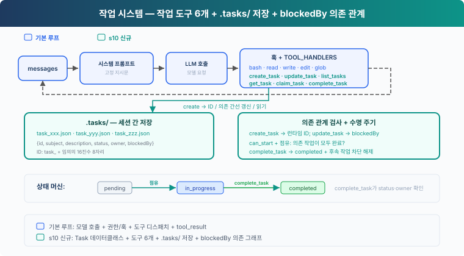
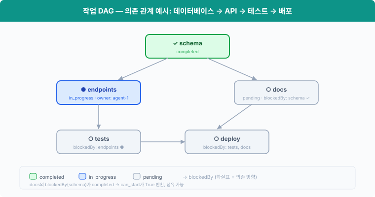

# s10: 작업 시스템 — 실행 체크리스트에서 조율 가능한 작업 상태로

[English](README.md) · [中文](README.zh.md) · [日本語](README.ja.md) · [한국어](README.ko.md)

s01 → ... → s08 → s09 → `s10` → [s11](../s11_background_tasks/) → s12 → ... → s16 → s17

> *"Break big goals into small tasks, order them, persist"* — 파일로 저장되는 작업 그래프이며, 멀티 에이전트 협업의 토대입니다.
>
> **하네스 레이어**: 작업 — 저장되는 목표, 복구할 수 있는 진행 상황입니다.

---

## 문제

s05의 TodoWrite로 에이전트는 현재 작업의 단계를 기록할 수 있습니다. 체크리스트 항목마다 내용과 상태가 있어서, 에이전트가 남은 일을 놓치지 않게 도와줍니다.

프로젝트를 데이터베이스 테이블 만들기, API 작성, 테스트 추가라는 세 작업으로 나누면, 하네스는 작업 사이의 관계도 알아야 합니다. API는 데이터베이스 테이블이 준비될 때까지 기다려야 하고, 테스트는 API가 안정될 때까지 기다려야 합니다. 각 작업을 누가 맡는지도 기록해야 합니다.

TodoWrite는 이런 의존 관계나 담당자를 기록하지 않습니다. "API 작성"이 끝나지 않았다는 사실은 보여 줄 수 있지만, 하네스는 그 정보로 이 작업을 시작해도 되는지 판단할 수 없습니다.

이 장에서는 작업 시스템을 추가합니다. 작업마다 고유한 ID와 상태가 있고, `blockedBy`에는 선행 작업을, `owner`에는 그 작업을 맡은 에이전트를 기록합니다.

---

## 해결 방법



코드는 S04의 기본 도구 5개, 권한, 훅, 공용 `execute_tool`을 그대로 두고, 작업 도구 6개, `.tasks/` 디렉터리 저장, `blockedBy` 의존 관계 검사를 더합니다.

TodoWrite와 작업 시스템 비교:

| | TodoWrite (s05) | 작업 시스템 (s10) |
|---|---|---|
| 역할 | 현재 작업의 실행 체크리스트 | 복구할 수 있는 작업 시스템 |
| 저장 위치 | 프로세스 안 / 세션 상태 | `.tasks/{id}.json` |
| 의존 관계 | 없음 | `blockedBy` 의존 그래프 |
| 수명 | 현재 세션 / 현재 작업 | 세션을 넘어 유지 |
| 조율 | 작업 점유 없음 | `owner` / 점유 |
| 상태 | pending / in_progress / completed | pending / in_progress / completed |
| 단위 | 에이전트 자신의 단계 | 점유하고, 추적하고, 차단을 풀 수 있는 작업 |
| 갱신 방식 | 체크리스트 전체를 교체 | 개별 레코드를 생성/조회/갱신/나열 |

---

## 동작 방식



### Task: 데이터 구조

각 작업은 JSON 파일 하나이며, `.tasks/` 디렉터리에 저장됩니다.

```python
@dataclass
class Task:
    id: str
    subject: str
    description: str
    status: str          # pending | in_progress | completed
    owner: str | None    # Agent responsible for this task
    blockedBy: list[str] # List of dependency task IDs
```

ID는 `task_` 접두사 뒤에 임의의 16진수 8자리를 붙여 만듭니다. 파일은 배타적으로 생성하며, 이미 있는 ID가 나오면 버리고 새로 만듭니다.

`TaskStore`는 작업 ID를 검증하고 JSON 파일을 읽고 씁니다. 이 장에서 쓰는 저장소는 `TASKS = TaskStore(TASKS_DIR)`입니다.

### create_task: 작업 만들기

```python
def create_task(subject: str, description: str = "") -> Task:
    return TASKS.create(subject, description)
```

`TaskStore.create`는 subject를 확인하고, 임의의 ID를 할당해 `.tasks/{id}.json`을 씁니다. 새 작업은 항상 빈 `blockedBy` 목록으로 시작합니다. 도구 결과는 런타임이 만든 ID를 모델에 돌려줍니다.

### update_task: 돌려받은 ID로 의존 관계 추가하기

```python
def update_task(task_id: str, addBlockedBy: list[str]) -> Task:
    return TASKS.update_dependencies(task_id, addBlockedBy)
```

작업 그래프는 두 단계로 만듭니다. 먼저 노드를 모두 만들고, 그다음 `create_task`가 돌려준 ID로 `update_task`를 호출해 간선을 추가합니다. 모델이 한 응답에서 도구 호출을 여러 개 내보낼 때 이 순서가 중요합니다. 함께 나온 호출들은 도구 결과가 하나도 없는 상태에서 만들어지므로, 한 `create_task` 호출이 다른 호출이 새로 만든 ID를 쓸 수 없기 때문입니다.

`update_task`는 저장하기 전에 변경 전체를 검증합니다. 대상 작업과 의존 작업이 모두 있어야 하고, 대상은 아직 pending이면서 담당자가 없어야 하며, 새 간선이 자기 의존이나 순환을 만들면 안 됩니다. 이미 있는 간선을 다시 추가해도 안전하며 중복되지 않습니다.

### can_start: 의존 관계 검사

작업은 `blockedBy`의 의존 작업이 모두 **completed**가 된 뒤에만 시작할 수 있습니다.

```python
def can_start(task_id: str) -> bool:
    return not incomplete_dependencies(load_task(task_id))
```

`incomplete_dependencies`는 선행 작업을 하나씩 불러옵니다. 선행 작업 중 하나라도 완료되지 않았거나 파일이 사라졌다면 그 작업은 점유할 수 없습니다.

### claim_task: 작업 점유하기

에이전트는 작업을 시작할 때 `claim_task`를 호출합니다. 이 함수는 `owner`를 설정하고 상태를 `pending` → `in_progress`로 바꿉니다. `owner` 필드에는 작업을 점유한 주체가 기록됩니다.

```python
def claim_task(task_id: str, owner: str = "agent") -> str:
    task = load_task(task_id)
    if task.status != "pending":
        return f"Task {task_id} is {task.status}, cannot claim"
    dependencies = incomplete_dependencies(task)
    if dependencies:
        return f"Blocked by: {dependencies}"
    task.owner = owner
    task.status = "in_progress"
    TASKS.save(task)
    return f"Claimed {task_id} ({task.subject})"
```

작업이 pending이 아니거나 의존 작업이 완료되지 않았다면 점유는 거부됩니다. S10은 작업 상태를 순차적으로만 갱신합니다.

### complete_task: 완료하고 차단 풀기

작업이 끝나면 상태를 `completed`로 바꿉니다. 동시에 다른 작업을 모두 훑어 **방금 차단이 풀린** 후속 작업을 찾습니다.

```python
def complete_task(task_id: str, owner: str = "agent") -> str:
    task = load_task(task_id)
    if task.status != "in_progress":
        return f"Task {task_id} is {task.status}, cannot complete"
    if task.owner != owner:
        return f"Task {task_id} is owned by {task.owner}, not {owner}"
    ready_before = {t.id for t in list_tasks()
                    if t.status == "pending" and t.blockedBy
                    and can_start(t.id)}
    task.status = "completed"
    TASKS.save(task)
    unblocked = [t.subject for t in list_tasks()
                 if t.status == "pending" and t.blockedBy
                 and t.id not in ready_before
                 and can_start(t.id)]
    msg = f"Completed {task_id} ({task.subject})"
    if unblocked:
        msg += f"\nUnblocked: {', '.join(unblocked)}"
    return msg
```

"schema"를 완료하면 "endpoints"와 "docs"에 대해 `can_start`가 True를 돌려주므로, 두 작업을 시작할 수 있습니다.

### get_task: 전체 내용 보기

`list_tasks`는 한 줄 요약만 보여 줍니다. `get_task`는 description과 의존 관계 정보까지 담긴 작업 JSON 전체를 돌려줍니다. 세션을 넘어 작업을 복구할 때, 에이전트는 전체 description을 읽어야 일을 이어 갈 수 있습니다.

```python
def get_task(task_id: str) -> str:
    task = load_task(task_id)
    return json.dumps(asdict(task), indent=2)
```

### 상태 기계: 동작 두 개, 상태 세 개

```
pending ──claim──→ in_progress ──complete──→ completed
```

여기서 `claim` / `complete`는 동작이고, `pending` / `in_progress` / `completed`는 상태입니다.

- **claim_task**: `pending` → `in_progress`. owner를 설정하고 작업을 시작합니다.
- **complete_task**: `in_progress` → `completed`. 작업을 완료로 표시하고 후속 작업의 차단을 풉니다.

### 전체 흐름

```python
# Phase 1: create every node and receive its runtime ID
schema = create_task("setup database schema")
endpoints = create_task("create API endpoints")
tests = create_task("write tests")
docs = create_task("write docs")

# Phase 2: add edges using those returned IDs
update_task(endpoints.id, addBlockedBy=[schema.id])
update_task(tests.id, addBlockedBy=[endpoints.id])
update_task(docs.id, addBlockedBy=[schema.id])

# Agent claims the first available task
claim_task(schema.id)       # ✓ Claimed (no dependencies)
complete_task(schema.id)    # ✓ Completed → unblocks endpoints, docs

claim_task(endpoints.id)    # ✓ Claimed (schema completed)
complete_task(endpoints.id) # ✓ Completed → unblocks tests

claim_task(docs.id)         # ✓ Claimed (schema completed)
complete_task(docs.id)      # ✓ Completed

claim_task(tests.id)        # ✓ Claimed (endpoints completed)
complete_task(tests.id)     # ✓ Completed
```

`create_task`는 호출할 때마다 JSON 파일을 하나 쓰고, `update_task`, `claim_task`, `complete_task`는 그 파일을 갱신합니다. 세션이 바뀌어도 `.tasks/` 디렉터리는 남아 있으므로, 에이전트는 파일을 읽어 진행 상황을 복구합니다.

---

## 직접 해 보기

```sh
cd learn-claude-code
python s10_task_system/code.py
```

다음 프롬프트를 입력해 보세요.

1. `Create tasks: setup database schema, create API endpoints (depends on schema), write tests (depends on endpoints), write docs (depends on schema)`
2. `List all tasks and their statuses`
3. `Claim the first unblocked task and complete it`
4. `List tasks again — which ones are now unblocked?`

`.tasks/` 디렉터리에 JSON 파일이 생기는지, 작업을 완료한 뒤 막혀 있던 작업의 차단이 풀리는지 살펴보세요.

---

## 다음 장

작업 그래프는 갖춰졌지만, 전체 테스트 스위트 실행, 의존성 설치, 배포 명령은 오래 걸릴 수 있습니다. 이런 명령을 동기적으로 실행하면 에이전트 루프는 현재 도구 호출에 묶여, 명령이 끝날 때까지 다음으로 넘어가지 못합니다.

s11 백그라운드 작업 → 느린 작업은 백그라운드에서 실행합니다. 에이전트 루프는 다른 작업을 계속 처리하다가, 백그라운드 작업이 끝나면 알림을 받습니다.
