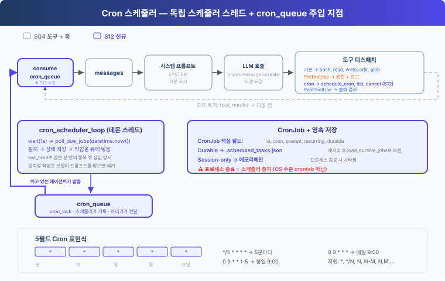

# s12: Cron 스케줄러 — 정해진 시간에 작업 시작하기

[English](README.md) · [中文](README.zh.md) · [日本語](README.ja.md) · [한국어](README.ko.md)

s01 → ... → s10 → s11 → `s12` → [s13](../s13_agent_teams/) → ... → s17

---

## 문제

S11은 명령이 시작된 뒤 실행되는 방식을 바꿉니다. 오래 걸리는 Bash 명령을 백그라운드에서 돌릴 수 있습니다. 하지만 앞으로의 작업을 언제 시작할지는 기록하지 않고, 현재 시각을 계속 확인하는 구성 요소도 없습니다.

"매일 아침 9시에 테스트를 돌려 줘"나 "30분마다 CI 상태를 확인해 줘" 같은 요청이라면, 사용자가 정해진 시각마다 프롬프트를 다시 보내야 합니다. 하네스는 일정을 저장하고, 시각이 되면 해당 프롬프트를 대기 큐에 넣고, 에이전트가 쉬고 있을 때 에이전트 루프에 전달해야 합니다.

---

## 해결 방법



에이전트가 다음 작업을 등록했다고 해 봅시다.

```text
cron:   0 9 * * *
prompt: run tests
```

현지 시각 09:00이 되면 스케줄러 스레드가 이 작업과 일치하는 것을 확인하고 `[Scheduled] run tests`를 `cron_queue`에 넣습니다. 큐 처리기는 에이전트가 쉴 때까지 기다렸다가 에이전트 루프의 한 턴을 시작합니다. 그러면 모델이 Bash를 호출해 테스트를 실행할 수 있습니다.

S12 코드는 S04의 기본 도구 5개와 훅을 유지하고 `schedule_cron`, `list_crons`, `cancel_cron`을 더합니다. S11의 백그라운드 명령은 넣지 않습니다. 이 장에서 전달하는 것은 작업을 시작할 프롬프트이지, 이미 실행 중인 명령의 결과가 아니기 때문입니다.

---

## 동작 방식

### CronJob에 저장하는 것

```python
@dataclass
class CronJob:
    id: str
    cron: str
    prompt: str
    recurring: bool
    durable: bool
    pending_delivery: bool = False
    last_fired: str | None = None
```

`cron`은 작업이 언제 실행 시각이 되는지 정합니다. `prompt`는 에이전트에게 보내는 작업입니다. `pending_delivery`는 실행 시각이 됐지만 모델이 아직 받아들이지 않은 작업을 표시하고, `last_fired`는 같은 분 안에 다시 큐에 넣는 것을 막습니다.

### 다섯 필드 cron 표현식

```text
minute hour day month weekday
   *     *    *    *      *    every minute
   0     9    *    *      *    every day at 09:00
  */5    *    *    *      *    every 5 minutes
   0     9    *    *     1-5   weekdays at 09:00
```

이 장에서는 `*`, `*/N`, `N`, `N-M`, `N,M,...`을 지원합니다. `schedule_job()`은 작업을 저장하기 전에 `validate_cron()`을 호출해, 필드 개수가 틀리거나 범위를 벗어난 값이 있는 표현식을 거부합니다.

### 시각이 되면 큐에 넣기

스케줄러 스레드는 1초마다 현지 시각을 읽습니다. 표현식이 일치하고 현재 분에 아직 실행되지 않은 작업이면, `_enqueue_due_job()`이 `pending_delivery`와 `last_fired`를 먼저 저장한 뒤 작업을 메모리 안의 큐에 넣습니다.

```python
def poll_due_jobs(moment: datetime):
    minute_marker = moment.strftime("%Y-%m-%d %H:%M")
    with cron_lock:
        for job in list(scheduled_jobs.values()):
            if job.pending_delivery or job.last_fired == minute_marker:
                continue
            if cron_matches(job.cron, moment):
                _enqueue_due_job(job, minute_marker)
```

저장에 실패하면 `_enqueue_due_job()`은 이전 상태로 되돌리고, 메모리에만 있는 전달을 큐 처리기에 내보내지 않습니다.

### 에이전트가 쉴 때 전달하기

`queue_processor_loop()`는 시각을 확인하지 않습니다. 큐를 확인합니다. 그리고 `agent_lock`이 있어서 사용자 턴이 실행되는 동안에는 예약된 턴이 세션을 바꾸지 못합니다.

```python
def queue_processor_loop(stop_event=RUNTIME_STOP):
    while not stop_event.wait(0.2):
        if not has_cron_queue() or not agent_lock.acquire(blocking=False):
            continue
        try:
            if has_cron_queue():
                run_agent_turn_locked()
        finally:
            agent_lock.release()
```

에이전트 루프는 실행 시각이 된 작업을 큐에서 꺼내 각각을 새 사용자 메시지로 덧붙입니다.

```python
fired = consume_cron_queue()
for job in fired:
    messages.append({"role": "user", "content": f"[Scheduled] {job.prompt}"})
```

모델 호출이 실패하면 이 메시지들은 현재 세션에서 지워지고 작업은 큐로 돌아갑니다. 모델이 호출을 받아들이면 한 번만 실행하는 작업은 삭제되고, 반복 작업은 다음에 일치할 때까지 `pending_delivery`를 해제합니다.

### 영속성의 경계

| 모드 | 저장 위치 | 프로세스를 다시 시작한 뒤 |
|---|---|---|
| `durable=True` | `.scheduled_tasks.json` | 다시 불러옴 |
| `durable=False` | 메모리 | 사라짐 |

코드는 임시 파일과 `os.replace()`로 `.scheduled_tasks.json`을 갱신합니다. 파일이 손상되어 있으면 시작할 때 이를 무시하지 않고 오류를 알립니다.

전달은 최소 한 번(at least once) 방식입니다. 모델이 프롬프트를 받아들인 뒤, 그 확인이 디스크에 기록되기 전에 프로세스가 종료되면, 다시 시작한 뒤 같은 작업이 한 번 더 전달될 수 있습니다.

### 런타임의 경계

- 스케줄러는 에이전트 프로세스의 현지 시각을 씁니다.
- 에이전트 프로세스가 종료되면 스케줄러도 멈춥니다. `durable`은 작업 정의만 보존합니다.
- 다시 시작하면 저장된 작업을 불러오지만, 프로세스가 내려가 있는 동안 놓친 실행 시각을 다시 실행하지는 않습니다.
- 예약된 턴은 큐 처리기 스레드에서 실행됩니다. 대화형 승인이 필요한 도구 호출은 메인 터미널과 입력을 두고 경쟁하지 않도록 거부됩니다.
- 스케줄러 스레드와 큐 처리기 스레드는 CLI에서만 시작됩니다. `code.py`를 import해도 백그라운드 스레드는 시작되지 않습니다.

에이전트가 꺼져 있을 때도 작업이 실행되어야 한다면 crontab, systemd 타이머, 또는 외부 스케줄러를 쓰세요.

---

## 직접 해 보기

```sh
cd learn-claude-code
python s12_cron_scheduler/code.py
```

다음 프롬프트를 차례로 입력해 보세요.

1. `Schedule "run date" every 2 minutes and keep it after restart.`
2. `List all cron jobs.`
3. `Cancel the cron job you just created.`

`.scheduled_tasks.json`을 열어 보고, 작업 시각이 되었을 때 `[Scheduled] run date` 메시지가 나타나는지 지켜보세요. 분 단위 일정을 테스트하는 동안에는 에이전트 프로세스를 계속 켜 두세요.

---

## 다음 장

스케줄러는 지정한 시각에 에이전트 루프의 턴을 시작할 수 있지만, 그 턴을 처리하는 것은 여전히 에이전트 하나입니다. 병렬 조사, 여러 모듈에 걸친 변경, 결과 종합이 필요한 작업이라면 하네스는 여러 에이전트에게 작업을 나누어 맡기고 각자가 만든 결과를 모아야 합니다.

s13 에이전트 팀 → 리더가 작업을 나누어 주고, 팀원은 각자 독립적으로 실행하며, 결과는 받은편지함으로 돌아옵니다.
