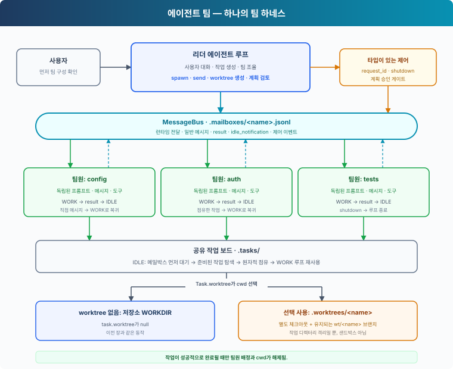
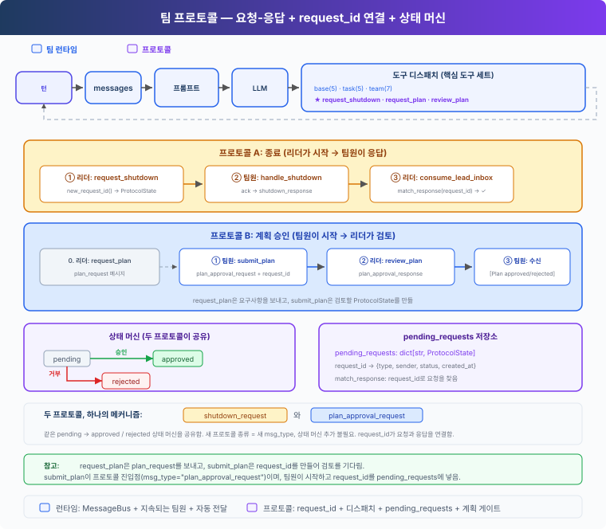

# s13: 에이전트 팀 — 런타임과 조율 프로토콜

[English](README.md) · [中文](README.zh.md) · [日本語](README.ja.md) · [한국어](README.ko.md)

s01 → ... → [s10](../s10_task_system/) → `s13` → [s14](../s14_mcp_plugin/) → s15 → s16 → s17

> *"When one agent cannot hold the whole job, let teammates divide the work."* — 오래 유지되는 팀원, 공유 작업 선택, 선택적 worktree, 조율 프로토콜을 다룹니다.
>
> **하네스 레이어**: 팀 — 여러 에이전트가 일을 나누고, 상태를 공유하고, 리더의 통제 아래에 머무는 방식입니다.

---

## 문제

에이전트에게 백엔드 전체를 리팩터링해 달라고 요청한다고 해 봅시다. 작업 범위에는 설정 로딩, 인증, 테스트가 들어갈 수 있습니다. 에이전트 하나가 이 영역들을 차례로 처리할 수도 있지만, 시간이 더 걸리고 앞에서 본 세부 내용은 점점 컨텍스트에서 밀려납니다.

병렬 작업에 잘 맞는 상황입니다. 하지만 사용자는 보통 팀을 설계하지 않고 목표만 말합니다.

```text
Refactor this sample backend. Clean up configuration loading,
authentication, and tests, preserve the existing interfaces,
and make sure the tests pass.
```

하네스는 서로 이어진 질문들에 답해야 합니다.

1. 병렬 작업이 유용하다고 누가 판단하고, 추가 에이전트는 누가 승인할까요?
2. 팀원은 여러 번 일을 맡는 동안 자기 정체성과 컨텍스트를 어떻게 유지할까요?
3. 모델에게 받은편지함을 폴링하게 하지 않고 결과를 리더에게 어떻게 돌려줄까요?
4. 쉬고 있는 팀원이 다음 배정을 기다리지 않고 준비된 작업을 가져갈 수 있을까요?
5. 병렬 편집이 충돌할 수 있을 때 작업은 어느 디렉터리를 써야 할까요?
6. 종료와 계획 승인을 어떻게 추적 가능하고 강제할 수 있는 프로토콜로 만들까요?

---

## 해결 방법



s13은 s10의 기본 도구, 훅, 권한 검사, 작업 시스템을 그대로 쓰고, 그 위에 리더가 관리하는 팀 런타임을 더합니다.

- **리더(Lead)** 는 사용자와의 대화를 맡고, 일을 어떻게 나눌지 제안한 뒤 승인을 기다립니다.
- **팀원(Teammate)** 은 각자 독립된 에이전트 루프를 돌리며 WORK와 IDLE을 오갑니다.
- **MessageBus** 는 파일 기반 메일박스로 일반 메시지, 결과, 제어 이벤트를 전달합니다.
- **런타임 전달**은 리더의 메일박스를 소비해 팀 이벤트를 다음 턴에 주입합니다.
- **공유 작업 보드**에서 쉬고 있는 팀원이 준비된 작업을 찾아 잠금 아래에서 점유합니다.
- **선택적 worktree**는 필요할 때 작업을 다른 작업 디렉터리에 묶습니다. 묶이지 않은 작업은 평소의 저장소 디렉터리를 씁니다.
- **타입이 있는 프로토콜과 계획 게이트**는 종료와 승인 상태를 명시적으로 드러내고, 필요한 계획이 승인될 때까지 변경 도구를 막습니다.

작업 그래프 작성은 s10의 2단계 규약을 따릅니다. 리더는 먼저 모든 노드에 대해 `create_task`를 호출하고, 돌려받은 런타임 ID로 `update_task(addBlockedBy=...)`를 호출한 다음에 준비된 작업을 배정합니다. `update_task`는 리더만 받습니다. 팀원은 작업을 조회하고, 점유하고, 완료할 수 있지만, 팀이 돌아가는 동안 그래프 구조를 고쳐 쓸 수는 없습니다.

s11의 백그라운드 작업과 s12의 예약 작업은 이 장으로 가져오지 않습니다. 팀원 간 통신, 작업 점유, 계획 승인 어디에도 두 메커니즘이 필요하지 않기 때문입니다.

이 모두가 팀 하네스 레이어의 구성 요소입니다. 팀원에게 작업 탐색용 루프가 따로 필요하지 않고, worktree가 새로운 종류의 에이전트를 만드는 것도 아닙니다.

---

## 동작 방식

### 1. 리더가 팀을 제안하고 사용자 승인을 기다린다

팀원을 띄우면 비용, 동시성, 그리고 작업 공간을 편집할 수 있는 주체의 범위가 달라집니다. 리더의 시스템 프롬프트는 이 경계를 분명히 드러냅니다.

```python
"When parallel work would help, first propose a small team with clear "
"responsibilities and wait for the user's confirmation. Do not call "
"spawn_teammate before the user confirms."
```

첫 요청에서 리더는 분할안만 제안합니다.

```text
I suggest three parallel areas:
- config: clean up configuration loading
- auth: refactor authentication
- tests: add regression coverage

I will start the teammates after you confirm.
```

사용자가 "Go ahead"라고 답하면 리더는 `spawn_teammate`를 호출할 수 있습니다. 리더는 먼저 Task를 만들고 그 첫 `task_id`를 팀원에게 넘깁니다. 사용자는 목표를 말하고, 리더는 팀을 설계하고, 사용자는 실행 범위를 승인합니다.

### 2. 팀원마다 독립된 루프를 가진다

s06의 서브에이전트는 한 번 호출하고 끝납니다. 팀원은 오래 유지되는 실행 단위입니다.

| | s06 서브에이전트 | s13 팀원 |
|---|---|---|
| 수명 주기 | 한 번 호출하면 끝남 | 종료 전까지 `WORK → IDLE → WORK` |
| 컨텍스트 | 작업 하나 동안만 존재 | 여러 배정에 걸쳐 유지 |
| 통신 | 결과 하나를 반환 | 메시지를 받고 이벤트를 보냄 |
| 조율 | 한 방향 위임 | 리더와 양방향 협업 |

`TeammateRuntime`은 팀원마다 고유한 시스템 프롬프트, 메시지, 도구, 현재 Task를 주고, WORK / IDLE 루프를 데몬 스레드에서 돌립니다. 팀원이 일하는 동안에도 리더는 계속 조율할 수 있습니다. `lead`와 `agent`라는 이름은 런타임 식별자로 예약되어 있지만, `MessageBus`는 여전히 `lead`를 조율자 메일박스로 받아들입니다.

`spawn_teammate`는 스레드를 시작하기 전에 첫 Task를 점유합니다. 점유에 실패하면 팀원은 시작되지 않습니다. Task가 없으면 작업 공간 도구와 Shell 도구는 저장소 디렉터리로 대신 넘어가지 않고 팀원에게 작업을 먼저 점유하라고 요구합니다.

### 3. MessageBus가 통신을 모델 컨텍스트 밖에 둔다

리더와 팀원은 messages 배열 하나를 함께 쓸 수 없습니다. 그러면 한 팀원의 도구 결과가 다른 팀원의 추론에 섞여 들어갑니다. `MessageBus`는 에이전트마다 `.mailboxes/<name>.jsonl` 받은편지함을 줍니다.

```python
class MessageBus:
    def send(self, from_agent, to_agent, content,
             msg_type="message", metadata=None):
        msg = {
            "from": from_agent,
            "to": to_agent,
            "content": content,
            "type": msg_type,
            "metadata": metadata or {},
        }
        with self._changed:
            MAILBOX_DIR.mkdir(parents=True, exist_ok=True)
            with self._path(to_agent).open("a", encoding="utf-8") as handle:
                handle.write(json.dumps(msg, ensure_ascii=True) + "\n")
            self._changed.notify_all()

    def wait_for_messages(self, agent, timeout=None):
        deadline = None if timeout is None else time.monotonic() + timeout
        with self._changed:
            while not self.peek(agent):
                remaining = (None if deadline is None
                             else deadline - time.monotonic())
                if remaining is not None and remaining <= 0:
                    return []
                self._changed.wait(remaining)
            return self._read_unlocked(agent)
```

잠금은 메일박스 파일을 동시 접근에서 보호합니다. `Condition` 덕분에 런타임은 메시지가 오면 팀원을 깨울 수 있고, IDLE 상태에서 쓰는 짧은 타임아웃도 지원합니다.

### 4. 런타임이 받은편지함 이벤트를 전달한다

`read_inbox()`는 메일박스 파일을 읽고 지우는 방식으로 메시지를 소비합니다. 그래서 리더 쪽 소비자는 `consume_lead_inbox()` 하나만 둡니다.

```python
def consume_lead_inbox():
    messages = BUS.read_inbox("lead")
    for message in messages:
        if message["type"].endswith("_response"):
            match_response(...)
    return messages
```

CLI 루프는 터미널 입력과 리더의 메일박스를 동시에 기다립니다. 메시지가 도착하면 다음 리더 턴을 시작하기 전에 메일박스를 소비합니다.

```text
MessageBus → consume_lead_inbox
           → update protocol state
           → inject [Team events] into history
           → start another Lead turn
```

팀원을 띄운 뒤 리더는 `list_teammates`나 `get_task`를 거듭 호출하지 않고 현재 턴을 끝냅니다. 팀 이벤트가 도착하면 런타임이 다음 턴을 시작합니다.

`check_inbox`는 모델 도구가 아닙니다. 메시지 도착은 런타임이 맡고, 모델은 런타임이 컨텍스트에 넣어 준 이벤트를 처리합니다.

### 5. 결과와 IDLE은 별개의 이벤트다

팀원이 배정 하나를 마치면 런타임은 이벤트 두 개를 차례로 보냅니다.

```text
result:            "Authentication refactored; related tests pass."
idle_notification: "Waiting for more work."
```

`result`는 "이번 배정으로 무엇이 나왔는가?"에 답하고, `idle_notification`은 "이 팀원이 일을 더 받을 수 있는가?"에 답합니다. 막연한 "done" 하나로는 두 사실을 모두 나타낼 수 없습니다.

IDLE 상태의 팀원은 종료하지 않습니다. 직접 온 메시지나 준비된 작업이 있으면 WORK로 돌아가고, `shutdown_request`를 받으면 정상 종료 핸드셰이크를 시작합니다.

### 6. IDLE은 준비된 작업을 찾기 전에 메일박스를 먼저 확인한다

IDLE에서는 메시지를 우선 처리한 다음 공유 작업 보드를 확인합니다.

```python
while True:
    inbox = BUS.wait_for_messages(name, IDLE_SCAN_INTERVAL)
    if inbox:
        should_stop = handle_messages(inbox)
        if should_stop or messages[-1]["role"] == "user":
            break
        continue

    task = claim_next_task(name)
    if task:
        messages.append({
            "role": "user",
            "content": f"[Auto-claimed task {task.id}] {task.subject}",
        })
        break
```

종료, 계획 승인, 리더의 직접 지시는 기회가 될 때 집어 드는 작업보다 먼저 처리되어야 합니다. 메시지도 준비된 작업도 없으면 팀원은 IDLE에 머뭅니다. 막혀 있던 작업은 다른 팀원이 선행 작업을 끝내면 준비 상태가 될 수 있습니다.

### 7. 탐색과 점유는 분리되고, 점유는 원자적이다

스캔은 후보를 찾기만 합니다.

```python
def scan_unclaimed_tasks() -> list[Task]:
    return [
        task for task in list_tasks()
        if task.status == "pending"
        and task.owner is None
        and can_start(task.id)
    ]
```

이 목록은 스냅샷입니다. 다른 팀원이나, 같은 작업 디렉터리를 쓰는 다른 하네스 프로세스도 같은 작업을 볼 수 있습니다. 그래서 소유권 변경은 `task_store_lock()` 아래의 `claim_task()` 안에서 일어납니다. 이 잠금은 프로세스 내부 잠금과 파일 잠금을 함께 씁니다.

```python
def claim_task(task_id: str, owner: str) -> str:
    with task_store_lock():
        task = load_task(task_id)
        if task.status != "pending" or task.owner is not None:
            return "Task is no longer available"
        if _owner_in_progress(owner):
            return "Owner must complete its current task first"
        if not can_start(task_id):
            return "Task is blocked"
        cwd, error = task_worktree_cwd(task)
        if error:
            return f"Cannot claim {task_id}: {error}"
        task.owner = owner
        task.status = "in_progress"
        save_task(task)
        teammate_assignments[owner] = {"task_id": task.id, "cwd": cwd}
        return f"Claimed {task.id}"
```

여러 팀원이 같은 후보를 발견할 수는 있지만, 그 작업을 `in_progress`로 옮길 수 있는 점유는 하나뿐입니다. 작업 파일은 같은 저장소 잠금을 잡은 채 임시 파일에 쓴 뒤 원자적으로 교체합니다. 팀원은 현재 작업을 끝내야 다른 작업을 점유할 수 있고, worktree 바인딩이 깨져 있으면 저장소 디렉터리로 대신 넘어가지 않고 안전하게 실패합니다.

### 8. 점유한 작업도 같은 WORK 루프를 쓴다

점유에 성공하면 런타임은 작업 ID, 제목, 설명을 팀원의 메시지에 주입합니다.

```text
ready task appears
  → IDLE teammate discovers it
  → claim_task writes owner and in_progress
  → task enters teammate messages
  → WORK
  → complete_task
  → result + idle_notification
  → IDLE
```

팀원은 리더에게 직접 배정받았을 때와 똑같이 모델 호출, 파일 도구, Shell, 계획 게이트, 결과 보고, 종료 프로토콜을 씁니다. 작업 탐색은 기존 WORK 루프로 들어가는 또 하나의 입구일 뿐입니다.

### 9. 작업이 도구의 작업 디렉터리를 정한다

`Task.worktree`는 선택 사항입니다.

```python
@dataclass
class Task:
    id: str
    subject: str
    description: str
    status: str
    owner: str | None
    blockedBy: list[str]
    worktree: str | None = None
```

디렉터리를 나누는 편이 낫다면 리더는 worktree를 만들어 작업에 묶을 수 있습니다.

```python
create_worktree(name="auth-refactor", task_id="task_1a2b3c4d")
```

`create_worktree`는 리더 전용 도구입니다. 대기 중이고, 소유자가 없고, 아직 묶이지 않은 작업만 받습니다. 이름, 경로, 브랜치, Git 레지스트리를 검증하고, 체크아웃을 만든 다음 작업 바인딩을 기록합니다. Git이 브랜치나 등록된 체크아웃을 남긴 채 실패를 보고하면, 런타임은 부분적으로만 수행되었다고 알리고, 작업은 묶지 않은 채로 두며, 수동 복구를 위해 남은 결과물을 보존합니다. 팀원에게는 작업 도구와 파일 도구만 보입니다.

작업을 점유하면 해석된 디렉터리가 `teammate_assignments`에 저장됩니다. 그 팀원의 `bash`, `read_file`, `write_file`, `edit_file`, `glob` 래퍼는 이 배정에서 디렉터리를 읽습니다. worktree가 없는 작업은 `WORKDIR`로 해석되고, 점유한 Task가 없는 팀원은 이 작업 공간 도구들을 쓸 수 없습니다.

```python
cwd, error = task_worktree_cwd(task)
if not error:
    teammate_assignments[owner] = {
        "task_id": task.id,
        "cwd": cwd,
    }
```

`complete_task(task_id, owner)`는 호출한 쪽이 진행 중인 그 작업의 소유자인지 확인합니다. 완료에 성공하면 결과를 기록하지만, 해당 모델 턴이 끝날 때까지는 배정된 디렉터리를 그대로 선택해 둡니다. 그래서 같은 응답 안의 뒤이은 도구 호출도 그 작업의 worktree에 머뭅니다. 런타임은 팀원이 IDLE로 돌아갈 때 배정을 해제합니다. 완료에 실패하면 배정을 유지해 팀원이 작업을 고치고 다시 시도할 수 있게 합니다.

재시작 후에는 `assignment_cwd()`가 영속 저장된 작업 소유자와 worktree 바인딩으로 진행 중인 배정을 다시 만들 수 있습니다. 같은 소유자가 다른 작업으로 옮겨 갔다면 오래된 로컬 임대도 교체합니다. 바인딩이 없거나 잘못되었으면 작업을 조용히 저장소 디렉터리로 돌리지 않고 안전하게 실패합니다.

> worktree는 Git 작업 디렉터리와 브랜치를 분리합니다. 샌드박스가 아닙니다. Shell 명령은 여전히 부모 프로세스에 허용된 경로와 리소스에 접근할 수 있습니다.

### 10. worktree 제거는 호스트가 맡는다

모델은 작업에 묶인 worktree를 만들 수는 있지만 제거할 수는 없습니다. 정리는 호스트 헬퍼의 몫으로 남겨 두어, 사용자나 호스트가 먼저 작업 소유권, 배정 임대, Git 상태를 살펴볼 수 있게 합니다. 이 헬퍼는 대기 중이거나 진행 중인 작업의 바인딩과 현재 턴의 임대가 있으면 제거를 거부합니다. 파괴적인 선택을 명시하지 않으면 추적 중인 파일, 추적되지 않는 파일, 무시된 파일 모두 제거를 막습니다.

`remove_worktree(name, discard_changes=True)`는 이미 사용자의 명시적 승인을 받은 호스트 코드만 쓰도록 남겨 둡니다. 어느 제거 경로든 `wt/<name>` 브랜치는 남기며, upstream이 없는 깨끗한 로컬 커밋도 보존됩니다. 제거에 성공하면 체크아웃이 더는 존재하지 않으므로 작업 바인딩을 지웁니다.

```text
clean worktree   → host may remove directory and retain wt/<name> branch
changed worktree → user decides how to preserve or discard it
pending/running task → refuse removal
```

작업 완료도 worktree 정리와 분리됩니다. `complete_task`는 작업 결과를 기록합니다. 팀원이 IDLE에 들어간 뒤 사용자나 호스트가 worktree를 살펴보고, 병합하거나, 남겨 두거나, 제거할 수 있습니다.

### 11. 제어 메시지는 타입과 요청 ID를 쓴다

일반 협업에는 자유 형식 텍스트로도 충분하지만, 종료와 승인이 의도를 짐작하는 데 기대서는 안 됩니다. 이 둘은 구조화된 메시지를 씁니다.



```python
@dataclass
class ProtocolState:
    request_id: str
    type: str
    sender: str
    target: str
    status: str
    payload: str
    work_version: int | None = None
    task_id: str | None = None


pending_requests: dict[str, ProtocolState] = {}
```

종료 경로는 다음과 같습니다.

```text
Lead creates a pending shutdown request
  → shutdown_request(request_id) enters the teammate inbox
  → the teammate finishes its current step
  → shutdown_response(request_id) returns to Lead
  → request_id locates the original request
  → pending becomes approved and the teammate loop exits
```

ID는 응답 하나를 요청 하나와 짝짓고, 타입은 엉뚱한 응답이 상태를 바꾸지 못하게 막고, 상태는 중복 응답이 두 번 반영되지 않게 막습니다.

### 12. 계획 승인이 실행을 제약한다

계획 프로토콜은 반대 방향으로 흐릅니다.

```text
Lead → plan_request
teammate → plan_approval_request(request_id, plan)
Lead → plan_approval_response(request_id, approve, feedback)
```

팀원이 먼저 계획을 세워야 한다는 것을 리더가 이미 안다면, `spawn_teammate(..., task_id=task.id, require_plan=True)`가 팀원 스레드를 시작하기 전에 Task를 점유하고 게이트를 켭니다. 이미 실행 중인 팀원에게도 `request_plan`으로 계획을 요구할 수 있습니다.

도구 디스패치가 게이트를 강제합니다.

```python
def _run_teammate_tool(name, block, handlers):
    gate = plan_gates.get(name, "not_required")
    if block.name in {"bash", "write_file", "edit_file"} and gate not in {
        "not_required", "approved"
    }:
        return f"Blocked: plan status is {gate}."
    try:
        return handlers[block.name](**block.input)
    except Exception as error:
        return f"Error: {type(error).__name__}: {error}"
```

상태가 `required`, `pending`, `rejected`인 동안 팀원은 파일을 읽고 계획을 제출하거나 고칠 수 있지만, Shell 명령을 실행하거나 파일을 쓰거나 편집할 수는 없습니다. 제출된 계획에는 팀원의 현재 작업과 작업 버전이 기록됩니다. Task를 점유하거나 해제하면 이 버전이 바뀌어 이전 승인이 무효가 됩니다. 일반 메시지는 작업의 정체성도 승인 상태도 바꾸지 않습니다.

팀원은 백그라운드 스레드에서 사용자 입력을 읽지 않습니다. 위험한 명령이나 작업 공간 밖의 경로는 권한 오류를 돌려주고, 리더가 사용자와 함께 판단하게 합니다.

---

## 전체 실행 예시

```text
s13 >> Put the backend refactor on a shared task board. Clean up
       configuration, authentication, and tests in parallel where possible.
       Use a worktree for authentication, preserve existing interfaces,
       and make sure the tests pass.

Lead: I suggest config, auth, and tests as three areas.
      Shall I start the team?

s13 >> Go ahead.

[task] config created
[task] auth created → worktree auth-refactor
[task] tests created
[claim] alice → config (cwd: repository)
[claim] bob → auth (cwd: .worktrees/auth-refactor)
[teammate] alice spawned
[teammate] bob spawned
[complete] auth
[bus] bob → lead (result) ...
[bus] bob → lead (idle_notification) ...
[wake: 2 team events → new turn]
Lead: I received the authentication result and will coordinate the rest.
```

터미널에는 사용자 요청, 리더의 제안, 작업 상태, 점유, 선택된 디렉터리, 결과, IDLE 전환, 제어 이벤트가 드러납니다. 사용자가 리더를 지정하거나 받은편지함을 확인하라고 시킬 필요가 없습니다.

---

## s10에서 달라진 점

| 구성 요소 | s10 | s13 |
|---|---|---|
| 에이전트 | 에이전트 하나 | 리더 하나와 오래 유지되는 팀원들 |
| 사용자 흐름 | 요청을 실행 | 팀을 제안한 뒤 시작을 승인받음 |
| 통신 | 없음 | 파일 메일박스와 런타임 전달 |
| 수명 주기 | 루프 하나 | 팀원의 `WORK / IDLE / shutdown` |
| 공유 작업 | 에이전트 하나가 작업 도구를 씀 | IDLE 스캔과 팀원의 원자적 점유 |
| 작업 디렉터리 | 저장소 `WORKDIR` | 점유한 Task, 선택적으로 worktree |
| 보고 | 현재 에이전트의 출력 | `result`와 `idle_notification`을 분리 |
| 제어 | 없음 | 타입이 있는 종료·계획 승인 프로토콜 |
| 강제 | 팀 제약 없음 | 필수 계획이 변경 도구를 막음 |

---

## 직접 해 보기

```sh
cd learn-claude-code
python s13_agent_teams/code.py
```

평범한 요청으로 시작합니다.

```text
Put the backend refactor on a shared task board. Complete configuration,
authentication, and tests in parallel where dependencies allow. Use a
worktree for authentication, preserve existing interfaces, and summarize
the result.
```

리더가 팀을 제안하면 이렇게 답합니다.

```text
Go ahead.
```

`.tasks/`가 `pending`에서 `in_progress`, `completed`로 바뀌는지, `.mailboxes/`가 `result`와 `idle_notification`을 전달하는지, `.worktrees/`가 묶인 작업에만 생기는지 살펴보세요. 직접 온 메시지가 작업 보드 스캔보다 먼저 처리되는지, `complete_task`가 실패해도 팀원의 작업 디렉터리가 초기화되지 않는지도 확인해 보세요.

---

## 다음 장

리더와 팀원은 `code.py`에 직접 정의된 도구만 호출할 수 있습니다. Jira, 배포 플랫폼, 지식 베이스를 연결하려면 여전히 외부 시스템마다 도구 스키마와 핸들러를 따로 만들어야 합니다. 그 외부 도구가 바뀌면 강의 코드도 함께 고쳐야 합니다.

s14 MCP 도구 → 탐색과 호출을 하나로 묶은 프로토콜로 런타임에 외부 서비스를 연결하고, 그 도구들을 도구 풀에 더합니다.
