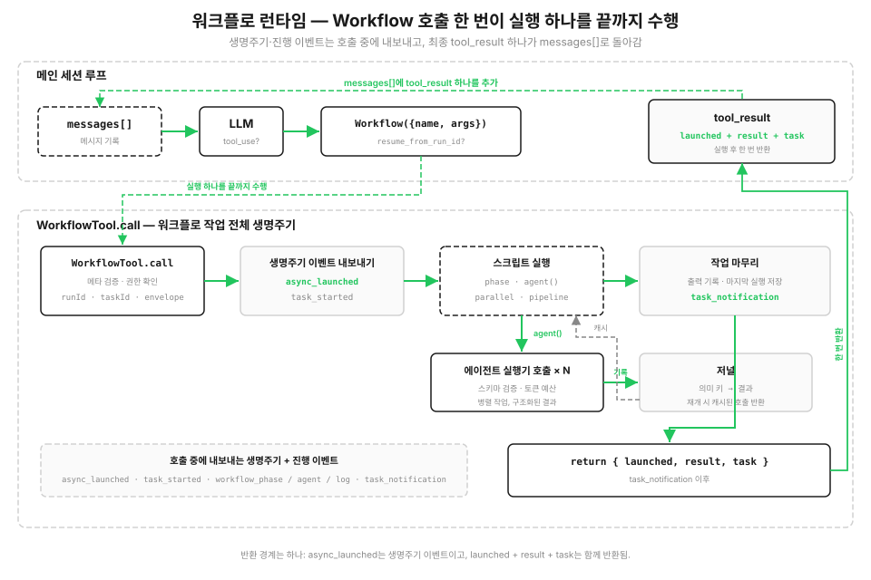

# s16: 워크플로 런타임 — 각 단계는 모델이, 오케스트레이션은 스크립트가 정합니다

[English](README.md) · [中文](README.zh.md) · [日本語](README.ja.md) · [한국어](README.ko.md)

s01 → ... → s14 → [s15](../s15_integrated_harness/) → `s16` → [s17](../s17_goal_loop/)

> *"One tool_use runs an entire orchestration"* — `Workflow` 도구는 여러 에이전트 호출을 조율하는, 복구 가능한 스크립트 런타임을 시작합니다.
>
> **하네스 레이어**: 오케스트레이션 — 단일 에이전트 루프 위에서 저장된 멀티 에이전트 스크립트를 실행합니다.

---

s01부터 s15까지는 모델이 라운드마다 어떤 도구를 호출할지 정했습니다. 도구 결과는 `messages[]`에 들어가고, 모델은 갱신된 컨텍스트를 보고 다음 단계를 정합니다. 이전 단계에서 무엇을 발견했느냐에 따라 경로가 달라질 때는 이 방식이 잘 맞습니다.

어떤 작업은 정해진 순서를 반복합니다. 코드 리뷰라면 여러 관점을 동시에 검사하고, 찾아낸 문제를 하나씩 검증하고, 중복을 합친 뒤 결과를 정렬할 수 있습니다. 순서와 의존 관계는 실행 전에 이미 알고 있습니다. 이때 호스트에게는 세 가지가 필요합니다.

- **병렬성**: 항목을 하나씩 기다리지 않습니다.
- **안정적인 결과 구조**: 에이전트마다 답이 달라도 결과의 형태는 같습니다.
- **복구 가능성**: 중단되더라도 이미 끝난 작업을 다시 실행하지 않습니다.

이 오케스트레이션이 대화 기록에만 있다면, 순서와 체크포인트도 그 기록에만 남습니다. 저장된 워크플로는 정해진 순서를 코드에 두고, 끝난 호출을 저널에 기록합니다.

## 계획은 대화 턴의 나열이 아니라 코드에 둡니다

하네스의 도구 풀에 `Workflow` 도구를 추가합니다. 호스트는 `agent()`, `parallel()`, `pipeline()`, `phase()`로 만든 신뢰할 수 있는 스크립트를 등록합니다. 모델은 저장된 워크플로 이름, 인자, 그리고 재개할 때 쓰는 실행 ID(선택)만 넘깁니다. 실행 가능한 코드나 메타데이터는 보내지 않습니다.

워크플로는 `tool_use` 하나로 메인 루프에 들어갑니다. 스크립트가 실행되는 동안 런타임은 생명주기 이벤트와 진행 이벤트를 내보내고, 모든 단계를 디스크의 저널에 기록합니다. 스크립트가 끝나면 호출은 시작 정보(launch envelope), 결과, 작업 상태를 돌려줍니다. 스크립트의 중간 결과는 대화 기록에 자리를 차지하지 않고 변수에 머뭅니다. `resume_from_run_id`로 다시 시작하면, 바뀌지 않은 `agent()` 호출은 저널 캐시에 적중해 이전 결과를 그대로 씁니다.



```python
SAMPLE_META = {"name": "review-changes", "description": "Review code changes", "phases": ["Review", "Verify"]}

async def sample_workflow(ctx, args):
    ctx.phase("Review")
    results = await ctx.pipeline(DIMENSIONS, audit, verify)   # Each dimension independently runs audit → verify
    confirmed = [f for r in results if r for f in r["confirmed"]]
    ctx.log(f"Confirmed {len(confirmed)} real issues")
    return {"confirmed": confirmed}
```

## Workflow 도구: 호출 한 번에 실행 하나를 끝까지

`Workflow`는 s15 호스트의 기존 도구 풀에 추가됩니다. 사용자가 저장된 워크플로를 요청할 수도 있고, 작업이 이미 아는 오케스트레이션과 맞으면 모델이 직접 고를 수도 있습니다. 어댑터는 호스트가 가진 `WORKFLOWS` 레지스트리에서 이름을 찾은 뒤, 신뢰할 수 있는 메타데이터와 함수를 런타임에 넘깁니다. s15의 다른 도구도 같은 루프에서 그대로 쓸 수 있습니다.

모델에게 보이는 스키마는 `name`, `args`, `resume_from_run_id`를 받습니다. 모르는 이름이나 형식이 잘못된 인자는 호스트 루프를 끝내지 않고 오류 도구 결과가 됩니다. 이어서 런타임은 등록된 메타데이터를 검증하고, 권한을 확인하고, 로컬 워크플로 작업을 등록한 뒤, 스크립트를 실행하기 전에 `async_launched`를 내보냅니다. 그다음 진행 이벤트가 이어지고 마지막에 `task_notification`이 옵니다. 호출은 JSON으로 안전하게 직렬화되는 시작 정보, 결과, 작업 상태를 돌려줍니다.

```python
WORKFLOW_TOOL = {
    "name": "Workflow",
    "input_schema": {
        "type": "object",
        "properties": {
            "name": {"type": "string"},
            "args": {"type": "object"},
            "resume_from_run_id": {"type": "string"},
        },
        "required": ["name"],
        "additionalProperties": False,
    },
}

async def run_workflow(name, args=None, resume_from_run_id=None):
    meta, script_fn = WORKFLOWS[name]
    out = await WorkflowTool().call(
        meta, script_fn,
        args=args,
        resume_from_run_id=resume_from_run_id,
    )
    return {"launched": out["launched"], "result": out["result"],
            "task": serialize_task(out["task"])}
```

## 워크플로 메타데이터: 시작 전에 검증합니다

저장된 워크플로마다 `name`, `description`, 그리고 선택 항목인 `phases`를 담은 신뢰할 수 있는 메타데이터를 등록합니다. 런타임은 워크플로 코드를 실행하기 전에 이를 검증합니다. `name`과 `description`은 UI에서 작업을 식별하고, `phases`는 진행 표시에 나오는 그룹 이름을 정합니다. 이 필드는 호스트 레지스트리에 속하며, 모델 입력에서 오지 않습니다.

등록 내용이 잘못되면 시작 전에 `WorkflowInputError`가 발생합니다. s12에서 cron 표현식을 검증한 것과 같은 생각입니다. 잘못 저장된 워크플로를 실행 시점이 되어서야 발견하지 않습니다.

런타임은 `meta.name`을 로컬 아티팩트 파일 이름에 쓰므로, 이 값은 영문자, 숫자, `.`, `_`, `-`로만 이루어진 1~64자의 안전한 slug여야 합니다.

```python
def validate_meta(meta):
    if not isinstance(meta, dict):
        raise WorkflowInputError("meta must be an object literal")
    if not meta.get("name") or not meta.get("description"):
        raise WorkflowInputError("meta requires name and description")
    if not isinstance(meta["name"], str) or not WORKFLOW_NAME_RE.fullmatch(meta["name"]):
        raise WorkflowInputError("meta.name must be a safe 1-64 character slug")
    if "phases" in meta and (
        not isinstance(meta["phases"], list)
        or not all(isinstance(p, str) and p for p in meta["phases"])
    ):
        raise WorkflowInputError("meta.phases must contain non-empty strings")
    return meta
```

## 오케스트레이션 프리미티브

스크립트는 몇 가지 오케스트레이션 프리미티브를 제공하는 `ExecutionState`를 받습니다. 스크립트가 파일을 직접 읽거나 셸 명령을 직접 실행하지는 않습니다. 기본 대화형 모드에서는 `agent()`가 호스트와 같은 실제 API 클라이언트에 연결되고, 각 워크플로 에이전트는 워크플로 인자로 전달된 내용만 읽습니다. `demo`와 단위 테스트는 `MockAgentRunner`를 써서 이벤트와 저널 재생이 매번 똑같이 나오게 합니다.

| 프리미티브 | 용도 |
|------|------|
| `agent(prompt, {schema, label, phase})` | 서브에이전트 하나를 디스패치합니다 |
| `parallel(thunks)` | **배리어**: 모든 작업을 동시에 실행하고 결과가 전부 돌아올 때까지 기다립니다 |
| `pipeline(items, *stages)` | **배리어 없이** 각 항목을 단계별로 통과시킵니다. 끝난 항목은 바로 다음으로 넘어갑니다 |
| `phase(title)` | 현재 진행 단계를 표시하고 진행 표시를 갱신합니다 |
| `log(message)` | 진행 로그 한 줄을 내보냅니다 |
| `workflow(name, args)` | 중첩 하위 워크플로를 실행합니다(한 단계까지만) |

각 항목이 같은 단계들을 독립적으로 거칠 때는 `pipeline`을 씁니다. 항목 A가 세 번째 단계에 이르렀을 때 항목 B는 아직 첫 단계에 있을 수 있습니다. 다음 단계가 앞 그룹의 결과를 모두 필요로 할 때는 `parallel`을 씁니다.

한 갈래가 실패하면, 두 프리미티브 모두 이미 시작된 다른 갈래가 끝나기를 기다린 뒤에 오류를 올립니다. `asyncio.to_thread()`에서 실행 중인 모델 요청은 그것을 기다리던 쪽이 취소되었다고 해서 멈추지 않습니다. 갈래들이 정리될 때까지 저널을 열어 두면, 성공한 호출이 재개에 쓸 결과를 저장할 수 있고, 마지막 작업 알림도 마지막 진행 이벤트 뒤에 오게 됩니다.

```python
async def parallel(self, thunks):
    results = await asyncio.gather(
        *[thunk() for thunk in thunks], return_exceptions=True
    )
    for result in results:
        if isinstance(result, BaseException):
            raise result
    return results
```

```python
async def pipeline(self, items, *stages):
    async def run_item(item, idx):
        value = item
        for stage in stages:
            value = await stage(value, item, idx)
        return value
    return await self.parallel([
        lambda it=it, i=i: run_item(it, i) for i, it in enumerate(items)
    ])
```

## 구조화된 출력: 서브에이전트가 긴 글을 돌려주지 않게 합니다

`agent({schema})`는 워크플로 에이전트에게 스키마에 맞는 JSON 객체만 돌려 달라고 요청합니다. 런타임은 결과를 파싱해 검증하고, 맞지 않으면 한 번 다시 시도합니다. 뒤따르는 코드는 글에서 필드를 뽑아낼 필요 없이 객체를 받습니다.

s05에서는 도구 인자를 완전히 믿을 수 없다고 경고했습니다. 이번에는 같은 교훈을 반대 방향에서 적용합니다. 서브에이전트의 출력도 완전히 믿을 수 없습니다. 오케스트레이션 경계에서 검증하고, 재시도를 한 번 주고, 나머지 흐름에는 불확실성이 들어오지 않게 합니다.

```python
run = await asyncio.to_thread(self.runner.run, prompt, schema, label)
result = run.value
if schema is not None:
    ok, err = SimpleJsonSchema(schema).validate(result)
    if not ok:                                       # Retry once with a reminder, then fail
        retry = await asyncio.to_thread(
            self.runner.run, prompt + "\n\nReturn valid JSON.", schema, label
        )
        result = retry.value
        ok, err = SimpleJsonSchema(schema).validate(result)
        if not ok:
            raise WorkflowInputError(f"agent({{schema}}) returned invalid output: {err}")
```

## 작업 상태와 진행 이벤트

`LocalWorkflowTask`는 상태와 토큰 사용량을 관리하고 SDK 스타일의 이벤트 스트림을 내보냅니다. 순서는 `task_started` → 단계 변경, 서브에이전트 시작, 로그 묶음을 담은 일련의 `task_progress` 이벤트 → 완료나 실패를 알리는 마지막 `task_notification` 하나입니다. 마지막 알림에는 출력 파일과 에이전트 수, 토큰 수도 함께 담깁니다.

데모는 이 이벤트를 순서대로 출력하고, 마지막 알림 뒤에 작업 상태를 돌려줍니다.

```python
class LocalWorkflowTask:
    def progress_event(self, ptype, **data):         # Phase/subagent/log
        self.progress.append({"type": ptype, **data})
        print(f"  progress   {ptype} ...")
```

## 저장소: 중단 후 재개를 위한 스냅숏 + 저널

런타임은 실행마다 `s16_workflow_runtime/.runtime/` 아래에 파일을 저장합니다. `<runId>.json` 스냅숏, `<runId>.output.json` 출력, `<runId>.journal.jsonl` 저널, `<runId>.lock` 조정 파일입니다. 새 실행은 저널을 열기 전에 배타적 파일 생성으로 새 `runId`를 확보합니다. 실행 잠금은 실행과 최종 저장이 끝날 때까지 유지되므로, 다른 프로세스가 같은 실행을 동시에 재개할 수 없습니다. 스냅숏에는 워크플로 이름, 인자, 작업 상태가 기록됩니다. 재개할 때는 성공한 아티팩트 중 어느 것도 바꾸기 전에 저장된 스냅숏과 저널을 먼저 검증합니다.

저널은 체크포인트 기반 재개의 핵심입니다. 모든 `agent()` 결과를 한 줄씩 기록합니다.

```python
class WorkflowJournal:
    def record(self, key, value):
        self._f.write(json.dumps({"key": key, "value": value}) + "\n")
        self._f.flush()
        self.cache[key] = value
```

## 재개: runId로 이어 가고 바뀌지 않은 것은 모두 재사용합니다

`resume_from_run_id`를 넣어 워크플로를 다시 호출하면 스크립트가 다시 실행되지만, 각 `agent()`는 결정적인 의미 키를 계산합니다. 그 키가 저널에 있으면 다시 실행하지 않고 캐시된 결과를 돌려줍니다. 바뀌지 않은 호출은 모두 캐시에 적중하고, 바뀐 호출과 그 호출에 의존하는 뒤 단계만 실제로 다시 실행됩니다.

핵심은 키가 동시 실행 순서에 의존하면 안 된다는 점입니다. `parallel`과 `pipeline` 안의 에이전트는 끝나는 순서가 매번 다릅니다. "n번째로 끝난 호출"을 키로 삼으면 다음 실행에서 캐시 항목이 엉뚱한 호출에 연결됩니다. 그래서 키는 공유 카운터가 아니라 호출 내용(종류, 레이블, 프롬프트, 스키마)의 안정적인 해시를 씁니다.

```python
def key(self, kind, label, prompt, schema):
    basis = f"{kind}|{label}|{prompt}|{json.dumps(schema, sort_keys=True)}"
    return f"{kind}-{_stable_hash(basis) % 10**10:010d}"

# Inside agent():
cached = self.journal.cached(key)
if cached is not MISS:
    self.task.progress_event("workflow_agent", label=label, status="cached")
    return cached
```

## 안정적인 호출 키

재개할 때 런타임은 현재의 각 `agent()` 호출을 이전 저널 기록과 짝지어야 합니다. 안정적인 해시를 쓰면 워크플로 코드와 인자가 바뀌지 않은 호출은 같은 호출 키를 얻습니다. 실제 모델 출력은 달라질 수 있지만, 호출 내용이 바뀌지 않았다면 재개는 저널에 이미 저장된 결과를 씁니다.

## 실행해 보기

예제 `review-changes` 워크플로는 `pipeline`으로 각 리뷰 관점을 audit → verify 단계에 독립적으로 보냅니다. 대화형 모드는 실제 API를 쓰고, 리뷰할 자료를 `args.changes`에서 읽습니다. `demo`는 고정된 runner 데이터로 pipeline, 검증, 저널, 재개 동작을 보여 줍니다.

```python
async def sample_workflow(ctx, args):
    ctx.phase("Review")
    changes = args.get("changes", "")

    async def audit(_v, dimension, _i):
        out = await ctx.agent(f"Inspect this change for {dimension} issues:\n{changes}",
                              schema=FINDINGS_SCHEMA, label=f"audit:{dimension}", phase="Review")
        return {"dimension": dimension, "findings": out["findings"]}

    async def verify(audited, dimension, _i):
        ctx.phase("Verify")
        verdicts = await ctx.parallel([                       # Verify every finding independently
            (lambda f=f: ctx.agent(f"Verify this finding against the change:\n{changes}\n\n{f}",
                                   schema=VERDICT_SCHEMA, label=f"verify:{dimension}:{f['title']}"))
            for f in audited["findings"]])
        return {"dimension": dimension,
                "confirmed": [f for f, v in zip(audited["findings"], verdicts) if v and v["isReal"]]}

    results = await ctx.pipeline(DIMENSIONS, audit, verify)
    ...
```

## s15에서 달라진 점

| | s15 통합 하네스 | s16 워크플로 런타임 |
|--|-----------|---------------------|
| 루프 | 모델이 이끄는 루프 하나 | 메인 루프는 그대로이고, 도구 하나가 스크립트로 짠 오케스트레이션을 실행 |
| 다음 단계를 정하는 주체 | 모델이 라운드마다 정함 | 스크립트가 오케스트레이션을 미리 선언 |
| 여러 에이전트 | 한 번 쓰고 끝나는 s06 서브에이전트 | agent-runner 경계를 거치는, 스크립트로 짜이고 재개 가능한 호출 |
| 새 메커니즘 | — | 스크립트 프리미티브, 호스트 레지스트리와 도구 어댑터, 작업 생명주기, 진행 이벤트, 저널/재개, 구조화된 출력 |

s16은 메인 루프를 대체하지 않습니다. 도구 레이어에 `Workflow`를 노출하고, 그 뒤에서 로컬 워크플로 런타임을 시작합니다. 저장된 스크립트 하나가 agent-runner 경계를 거쳐 N개의 호출을 조율합니다. s06 서브에이전트는 모델의 판단에 따라 한 번 디스패치되지만, s16은 오케스트레이션을 재개 가능한 호스트 코드로 바꿉니다.

## 직접 해 보기

```bash
python s16_workflow_runtime/code.py          # Both the main model and Workflow agents use the real API
python s16_workflow_runtime/code.py demo     # Deterministic review-changes fixture and event stream
python s16_workflow_runtime/code.py resume   # Resume by the last runId; every agent() hits the journal cache
```

기본 명령에서는 모델에게 변경 내용을 읽고, 그 텍스트를 `args.changes`에 넣어, 저장된 `review-changes` 워크플로를 실행하라고 요청합니다. 메인 모델과 워크플로 에이전트 모두 실제 API를 씁니다. `demo` 명령은 고정된 runner 데이터를 쓰므로 생명주기와 재개 동작을 몇 번이고 똑같이 관찰할 수 있습니다. 데모를 재개했을 때 모든 호출이 캐시에 적중하면 `agents=0 tokens=0`이 표시됩니다.

## 다음 장

[s17 목표 루프](../s17_goal_loop/)는 더 작고 독립적인 루프로 정해 둔 목표에 도달했는지 확인하고, 턴이 한 번 더 필요한지 결정합니다.
