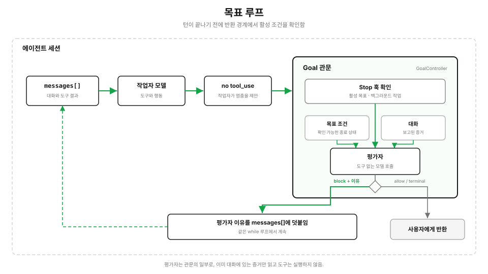

# s17: 목표 루프 — 멈출지는 모델이 제안하고, 계속할지는 독립 평가자가 정합니다

[English](README.md) · [中文](README.zh.md) · [日本語](README.ja.md) · [한국어](README.ko.md)

s01 → ... → s15 → [s16](../s16_workflow_runtime/) → `s17`

> *"The model making no more tool calls means that one turn wants to stop. A separate evaluator decides whether the whole goal is complete."* — 모델이 더 이상 도구를 호출하지 않는다는 것은 한 턴이 멈추려 한다는 뜻일 뿐입니다. 목표 전체가 끝났는지는 별도의 평가자가 판단합니다.
>
> **하네스 레이어: 이어서 실행하기.** 턴이 끝날 때마다 완료 조건을 확인하고, 남은 작업이 있으면 다음 턴을 시작합니다.

---



s01부터 에이전트 루프의 종료 조건은 하나였습니다. 모델이 도구 호출을 멈추면 프로그램이 반환합니다.

일반적인 대화라면 이것으로 충분합니다. 하지만 "모든 테스트가 통과할 때까지 계속 고쳐 줘"나 "모든 인수 조건을 끝내 줘" 같은 작업에는 늘 충분하지는 않습니다. 모델은 일부만 끝내 놓고 작업이 다 됐다고 믿을 수 있습니다. 새 `tool_use`가 없다는 것은 현재 턴이 끝났다는 뜻일 뿐, 목표 전체를 이뤘다는 증거는 아닙니다.

`/goal`은 실제로 반환하기 전에 독립적인 판단을 하나 더 거칩니다.

## /goal은 세션 범위의 Stop 훅입니다

다음과 같이 입력합니다.

```text
/goal pytest tests/auth exits with code 0 and lint reports no errors
```

프로그램은 완료 조건을 저장하고, 곧바로 그 조건을 현재 작업으로 메인 모델에게 넘깁니다. "작업을 시작해"라는 프롬프트를 따로 보낼 필요는 없습니다.

메인 모델이 도구 호출을 멈추면, 루프는 반환하기 전에 Goal Stop 훅을 실행합니다.

```python
if tool_results:
    messages.append({"role": "user", "content": tool_results})
    continue

decision = await self.goal.evaluate_after_turn(self.messages)
if decision.action == "block":
    self.messages.append({
        "role": "user",
        "content": decision.reason,
    })
    continue

return SessionResult(text=text, status=decision.action)
```

활성 목표가 없으면 훅은 바로 멈춤을 허용하므로, 반환 조건은 s01과 같습니다.

## 평가자는 작업자와 분리되어 있습니다

메인 모델은 코드를 고치고, 명령을 실행하고, 작업을 풉니다. Goal 평가자는 별도의 모델 호출이며, 완료 조건을 판정하는 일 하나만 맡습니다.

평가자는 `GoalController`가 Goal 관문의 내부 의존성으로 가지고 있습니다. 메인 루프 옆에 놓인 두 번째 반환 경로가 아닙니다.

이 장에는 별도의 `CommandQueue`가 없습니다. 평가 결과 멈춤이 막히면, 컨트롤러는 그 이유를 같은 `messages[]`에 덧붙이고 다음 턴을 시작합니다. 더 큰 호스트라면 사용자 입력, 백그라운드 결과, 이어서 실행하라는 명령을 세션으로 되돌려 보내는 데 공유 큐를 쓸 수도 있습니다. 하지만 그 큐는 호스트 전체의 전달 수단이지, Goal 관문이 소유하는 구성 요소가 아닙니다. 큐를 관문 안에 넣으면 판단과 그 판단을 전달하는 경로의 경계가 흐려집니다.

평가자가 보는 것은 다음과 같습니다.

- 활성 Goal 조건
- 지금까지의 대화
- 작업자가 그 대화에 남긴 도구 결과

평가자에게는 도구가 없습니다. 스스로 파일을 읽거나 테스트를 다시 돌릴 수 없습니다. 이미 대화에 있는 내용만 보고 판단할 수 있습니다.

```json
{
  "ok": false,
  "reason": "The conversation does not contain pytest's exit code yet.",
  "impossible": false
}
```

`ok=true`는 조건이 충족되었다는 뜻입니다. `ok=false`는 턴이 한 번 더 필요하다는 뜻입니다. 작업을 더 이상 끝낼 수 없게 되었다면 평가자는 `impossible=true`를 반환할 수 있습니다.

## 대화가 평가자의 입력입니다

평가자는 현재 대화를 읽습니다. 도구 결과, 작업자의 설명, 백그라운드 작업 알림은 모두 메시지로 대화에 들어오며, 판단은 그 메시지에 실제로 적힌 내용에 따라 달라집니다.

평가자 입력에는 가장 최근의 완전한 메시지들이 남습니다. 가장 새로운 메시지 하나만으로도 너무 크면, 그 메시지의 앞부분과 뒷부분을 남겨서 도구 결과 하나가 평가자 요청 전체를 채우지 못하게 합니다.

그렇다고 "테스트 통과" 같은 맨 주장을 그대로 받아들여야 한다는 뜻은 아닙니다. 평가자 프롬프트는 대화 안의 구체적인 결과를 명시적으로 요구하고, 결과가 보고되지 않은 명령이 성공했다고 가정하지 말라고 모델에게 지시합니다.

그래도 결국 텍스트를 읽는 모델이므로, 신뢰도는 중요한 결과가 얼마나 분명하게 드러났는지에 달려 있습니다. 그래서 작업자의 시스템 프롬프트에는 다음 내용이 들어 있습니다.

> After running a verification command, report the command and its result clearly enough for an independent evaluator to inspect.

Goal Loop는 테스트 프레임워크가 아닙니다. 실제 검증은 여전히 도구가 합니다. Goal 평가자는 그 검증 결과가 현재 작업 기록에 있는지만 판단합니다.

## 좋은 완료 조건은 확인할 수 있습니다

"코드를 좋게 만들어 줘"는 너무 모호합니다. 평가자는 "좋다"가 무슨 뜻인지 알 수 없습니다.

쓸모 있는 조건은 세 가지를 밝힙니다.

1. **최종 상태:** 작업이 끝났을 때 무엇이 참이어야 하는지
2. **확인 방법:** 어떤 명령이나 출력으로 그것을 증명하는지
3. **제약:** 작업하는 동안 무엇을 망가뜨리면 안 되는지

예를 들면 다음과 같습니다.

```text
/goal finish the authentication migration until pytest tests/auth exits 0,
without modifying test files outside tests/auth
```

사람이 지켜보지 않는 작업에 상한을 두어야 한다면, Goal 안에 고정 예산을 숨기지 말고 메인 루프의 전역 턴 제한을 쓰세요.

```bash
MAX_TURNS=20 python s17_goal_loop/code.py \
  "/goal fix the type errors until npm run typecheck exits 0"
```

## 끝나지 않은 작업은 같은 루프로 돌아갑니다

조건이 충족되지 않았다고 판단하면 평가자는 짧은 이유를 반환합니다.

```text
The conversation has no complete test result. Run pytest tests/auth and report its exit code.
```

프로그램은 그 이유를 `messages[]`에 덧붙이고 현재 `while` 루프에서 `continue`를 실행합니다. 메인 모델은 사용자가 "계속해"라고 입력하기를 기다리지 않고 다음 턴을 시작합니다.

이어서 실행하기 위한 별도의 큐는 없습니다. Goal 평가는 루프의 반환 경계에서 일어나고, 끝나지 않은 작업도 그 경계를 거쳐 돌아갑니다.

## 끝나지 않은 백그라운드 작업은 기다린 뒤 판단합니다

메인 모델이 현재 턴을 끝낼 때, 워크플로나 백그라운드 명령, 그 밖의 비동기 작업이 아직 실행 중일 수 있습니다.

이때 바로 평가하면 너무 이릅니다. 중요한 결과가 아직 대화로 돌아오지 않았기 때문입니다. Goal Stop 훅은 `defer`를 반환해 Goal을 활성 상태로 두고 평가자를 건너뜁니다. 작업이 끝나면 호스트가 완료 메시지를 `submit_background_result()`에 넘기고, 그 메시지가 같은 `messages[]`에 들어오면서 루프가 다시 시작됩니다.

워크플로 알림이라고 해서 동작상 특권이 있지는 않습니다. 다른 메시지처럼 대화에 들어오고, 평가자는 그 안에 담긴 실제 결과를 판단합니다.

## 자동으로 이어 가더라도 출구는 있어야 합니다

Goal에는 숨겨진 기본 예산(20턴 같은)이 없습니다. 평가자는 턴이 끝날 때마다 조건을 다시 판단합니다.

하지만 어떤 자동 메커니즘도 요청 하나를 영원히 붙잡고 있어서는 안 됩니다. 이 장은 목표 자체와는 별개로 일반적인 출구 두 개를 둡니다.

- 메인 루프의 전역 `max_turns`
- Stop 훅이 연속으로 막을 수 있는 횟수의 상한

제한에 도달하면 프로그램은 사용자에게 제어권을 돌려줍니다. 목표를 완료로 표시하지 않고, 몰래 지우지도 않습니다. 사용자는 상태를 확인하거나, 정보를 더 주거나, 계속하거나, 목표를 지울 수 있습니다.

평가자 오류도 같은 규칙을 따릅니다. 자동으로 이어 가기를 멈추고, 목표는 활성 상태로 두고, 완료 여부를 판단할 수 없었는데도 성공했다고 하는 대신 오류를 드러냅니다.

## 확인, 교체, 지우기

한 세션에는 활성 Goal이 많아야 하나입니다.

```text
/goal
```

조건, 경과 시간, 평가 횟수, 메인 에이전트의 토큰 사용량, 가장 최근 평가자 이유를 보여 줍니다.

```text
/goal a new completion condition
```

이전 Goal을 바꾸고, 새 조건으로 곧바로 작업을 시작합니다.

```text
/goal clear
```

활성 Goal을 지웁니다. `stop`, `off`, `reset`, `none`, `cancel`도 같은 뜻으로 받아들입니다.

`GoalController.restore()`는 호스트가 저장해 둔 `goal_status` 이벤트에서 아직 활성 상태인 Goal을 복원할 수 있습니다. 이 장의 CLI는 세션 전체를 저장하지 않습니다. 완료되었거나, 실패했거나, 지워진 Goal은 다시 시작하지 않습니다. 조건은 이어지지만, 턴 수, 경과 시간, 토큰 기준값은 새로 시작합니다.

## 코드에서 추가되는 것

이 장은 S04 커널 위에 만든 독립적인 메커니즘 예제입니다. 기본 도구 5개와 훅 지점 4개를 그대로 두고, Goal 전용 구성 요소 4개를 더합니다.

| 구성 요소 | 역할 |
|---|---|
| `GoalState` | 조건, 평가 횟수, 시작 시각, 가장 최근 이유를 저장합니다 |
| `PromptGoalEvaluator` | 별도의 모델 호출로 대화를 판단합니다 |
| `GoalController` | Goal을 설정·확인·지우고 Goal Stop 훅을 실행합니다 |
| `AgentSession` | Stop 훅을 원래의 반환 경계에 연결합니다 |

통합 지점은 몇 줄뿐입니다.

```python
decision = await self.goal.evaluate_after_turn(self.messages)
if decision.action == "block":
    continue
return SessionResult(text=text, status=decision.action)
```

## 직접 해 보기

의존성을 설치하고 `.env`를 준비합니다.

```bash
pip install -r requirements.txt

# .env
ANTHROPIC_API_KEY=...
MODEL_ID=...

# Optional: use a smaller model for Goal evaluation
GOAL_EVALUATOR_MODEL_ID=...
```

대화형 세션을 시작합니다.

```bash
python s17_goal_loop/code.py
```

그다음 다음과 같이 입력합니다.

```text
/goal python -m pytest exits with code 0
```

명령줄에서 Goal을 바로 설정할 수도 있습니다.

```bash
python s17_goal_loop/code.py "/goal python -m pytest exits with code 0"
```

## s16과의 관계

s16은 한 묶음의 작업을 어떻게 실행할지에 답합니다. 어떤 단계를 동시에 실행하는지, 결과를 어떻게 검증하는지, 중단된 실행을 어떻게 재개하는지입니다.

s17은 작업 전체가 끝났는지에 답합니다. 워크플로는 성공적으로 끝났는데 사용자의 최종 요구 사항은 아직 충족되지 않았을 수 있습니다. 워크플로 결과가 대화에 들어오면, Goal 평가자가 세션을 멈출지 이어 갈지 정합니다.

두 메커니즘은 각각 따로 쓸 수 있습니다. 한 호스트가 둘을 연결하면, 워크플로 완료 메시지가 대화에 들어오고 Goal Loop가 전체 작업에 턴이 한 번 더 필요한지 판단합니다.
